# Tintwork

An original, browser-based layered image editor built on the HTML Canvas 2D API.
No frameworks, no build step, no server-side processing: images never leave your browser.

Tintwork takes general inspiration from what desktop photo editors can do (layers, tools,
adjustments, filters, history) but has its own name, UI, icons and code. It does not use
any third-party branding, assets or proprietary code.

## What's new in v1.25 (upright / perspective UX)

v1.25 keeps to non-AI tools and focuses on **Windows mouse-first** upright/perspective friction. After **Plumb** or **Upright** refuses, the status bar shows a one-line plain-language reason (Plumb includes check-set **median/worst**). When Distortion ≠ 0, **Apply Lens + Full** is one click and **one undo** (Enter does the same). Perspective panel: A/L/V/F/G/P keys, clearer tooltips, default focus on Full, Esc/Enter clarified. USER_GUIDE perspective section documents when each mode works or refuses. Docs that cited library **0.73°** now mark it **in-sample**. Quality bars unchanged (library ≤0.5° still not reachable via Distortion; cathedral mixed still refused). See [docs/WORKFLOW_BENCHMARK.md](docs/WORKFLOW_BENCHMARK.md).

## What's new in v1.24 (honest Plumb measure)

v1.24 keeps to non-AI tools. **Plumb** now scores Distortion by **apply+measure on held-out edges** (ridge samples on the preview, pushed through lens undistort + Full upright), not analytical chord endpoints. Solve reports its time (~0.7s). Do-no-harm unchanged: brick and library Plumb still leave Distortion at 0 when the check set does not clearly improve. **Library ≤0.5° is not reachable with Distortion alone** (held-out worst stays ~3°). Cathedral mixed Suggest still refused. See [docs/WORKFLOW_BENCHMARK.md](docs/WORKFLOW_BENCHMARK.md).

## What's new in v1.23 (Plumb do-no-harm)

v1.23 keeps to non-AI tools. **Plumb** still samples at full resolution, but Distortion refine now scores **held-out detected verticals** (not the lines you drew). It only sets Distortion when the check set’s median **and** worst improve, signs agree across folds, and `Distortion`≥5; otherwise Distortion stays **0** and the status bar says **No reliable lens bend found**. Brick both traces and library Plumb now refuse unsafe bends. Library ≤0.5° still trails (manual Distortion remains). See [docs/WORKFLOW_BENCHMARK.md](docs/WORKFLOW_BENCHMARK.md).

## What's new in v1.22 (full-res Plumb + post-Full Distortion refine)

v1.22 keeps to non-AI tools. **Plumb** now samples edges at **full resolution** and **refines Distortion** by searching nearby slider values for the lowest post-Full residual (never worse than Distortion 0; auto capped at ±40). Measured: library Plumb → +10 → Full **0.73° in-sample** (still trails ≤0.5°; held-out worst stays ~3°); brick Plumb refine → +20 but **held-out Vs stay ~1°** (the 0.01° figure was in-sample overfit — disclosed). c4 ≤0.5° and geneva/hongkong Full refuse unchanged. See [docs/WORKFLOW_BENCHMARK.md](docs/WORKFLOW_BENCHMARK.md).

## What's new in v1.21 (manual Lens distortion + Plumb line)

v1.21 keeps to non-AI tools. Perspective gains a **Distortion** slider (barrel/pincushion, same sign as RAW Distortion) and optional **Vignette**, with live preview; **Apply Lens** is one undo and runs **before** Upright. **Plumb** lets you drag 1–3 edges that should be straight (snaps to detected edges) and solves Distortion from their bend. Automatic Full radial stays gated. Measured: library Distortion +10 then Full → **0.73° in-sample** (was 0.86° Full-only; still trails ≤0.5°; held-out worst stays ~3°). See [docs/WORKFLOW_BENCHMARK.md](docs/WORKFLOW_BENCHMARK.md).

## What's new in v1.20 (WebKit tests restored; lens-aware Full measured & stayed gated)

v1.20 keeps to non-AI tools. **Host WebKit deps** are installed again so `npm test` runs the full desktop/mobile WebKit suite without `TW_SKIP_WEBKIT`. **Lens-aware Full** was measured with force-apply of `kEst`: on library it *worsened* fixed seeds (0.86°→1.54°), so radial stays gated (`k=0`) with a compare-gate left in place for a future win. geneva/hongkong Full still refuse; c4 Full ≤0.5° on fixed vertical seeds. Suggest frame can take mixed when safe. See [docs/WORKFLOW_BENCHMARK.md](docs/WORKFLOW_BENCHMARK.md).

## What's new in v1.19 (Suggest pure-V ranking; brick/c4 clarified)

v1.19 keeps to non-AI tools. **Suggest guides** now detects on the full composite (same recipe as hand top-2), ranks well-separated vertical pairs, rejects short partners, and falls back to diversify top-2 unless a ranked pair clearly wins without hurting those edges. Held-out flat / lowangle / geneva no longer lose to hand top-2. The old brick/c4 "~17°" scorecard number was mostly **horizontal-seed residual** after good verticals (brick: non-level feature; c4: real keystone — Suggest mixed now cuts H to ~2°). Lens-aware Full radial stays gated (do-no-harm). See [docs/WORKFLOW_BENCHMARK.md](docs/WORKFLOW_BENCHMARK.md).

## What's new in v1.18 (Suggest guides, mixed V+H Guided quality)

v1.18 keeps to non-AI tools. **Suggest guides** picks 2–4 diverse vertical/horizontal edges for Guided upright (Enter applies; editable). Mixed V+H is accepted only when a probe says it beats a pure-vertical pair without hurting verticals — gated so held-out interiors stay safe. Suggest path is **2 actions** after open (vs Lightroom Guided hand path ~5). Lens-aware Full was **not** shipped (do-no-harm gate unchanged). See [docs/WORKFLOW_BENCHMARK.md](docs/WORKFLOW_BENCHMARK.md).

## What's new in v1.17 (perspective: refuse, constrain-crop, guide snap, grid)

v1.17 keeps to non-AI tools and focuses on upright/perspective. Measured on nine new CC0 held-out architecture photos first. Upright refuse no longer leaves Perspective open; Crop edges may keep a free aspect when that preserves more of the photo; Guided lines snap to detected edges; manual Perspective shows a thirds grid. Full upright ≤0.5° was not retuned. See [docs/WORKFLOW_BENCHMARK.md](docs/WORKFLOW_BENCHMARK.md).

## What's new in v1.16 (export output sharpening, Guided 2–4 guides)

v1.16 keeps to non-AI tools. **Output sharpening** on Export / presets / batch: Screen, Matte paper or Glossy paper at Low / Standard / High (after resize, before watermark; skipped on 16-bit PNG). **Guided upright** accepts up to four guides with a live preview after two; Enter, Apply guides, or the fourth guide finishes. Soft-proof ICC, heal % and Full ≤0.5° were not revisited. See [docs/WORKFLOW_BENCHMARK.md](docs/WORKFLOW_BENCHMARK.md).

## What's new in v1.13 (auto-apply upright, ink warning, sRGB embed, heal/fill)

v1.13 keeps to non-AI tools. Auto / Level / Vertical / Full / Guided upright **apply immediately** (no extra Enter), so Auto upright is two steps like Lightroom's. Soft proof gains an approximate **ink warning** overlay. JPEG exports embed an sRGB ICC profile; PNG exports always carry an sRGB chunk. Spot heal searches more carefully (still **79%** on the USDA portrait with the grain guard — same as v1.12); Fill empty edges mirrors nearby pixels before smoothing. `npm test`: **1013** checks. See [docs/WORKFLOW_BENCHMARK.md](docs/WORKFLOW_BENCHMARK.md).

## What's new in v1.12 (Full do-no-harm, Batch Open tabs, gated radial estimate)

v1.12 keeps to non-AI tools. Full upright refuses corrections that would make horizontals worse (including nearly level facades and dense near-vertical diagonals). Batch process gains **Open tabs**; Batch again can repeat that subset. A radial lens estimate is computed for diagnosis but **not** applied yet (it did not beat v1.11 on the library/brick tuning photos). New held-out photo: `hongkong.jpg`. See [docs/WORKFLOW_BENCHMARK.md](docs/WORKFLOW_BENCHMARK.md).

## What's new in v1.11 (batch remembers folders, Batch again, steadier Full upright)

v1.11 keeps to non-AI tools. See [docs/WORKFLOW_BENCHMARK.md](docs/WORKFLOW_BENCHMARK.md) for how each change was measured, including a new held-out photo that Full upright still makes worse.

- **Batch remembers its folders:** Batch process remembers the source folder and a new **Output folder** between sessions (Chrome/Edge folder access). In a new session the browser asks once to allow reading and saving there. A deleted or renamed output folder is detected and you are asked for a new one. If the output folder is the source folder, the files the last batch wrote are skipped.
- **File ▸ Batch again** (`Ctrl+Alt+Shift+B`): repeats the last batch (folders, preset or action, look, naming) without the dialog. Repeating the job 25 batch in a new session takes 4 steps (2 of them the browser's permission prompts), down from 7. It always processes the whole folder.
- **Drop onto Batch process:** drop image files or a folder onto the open dialog to make them the source.
- **Steadier Full / Vertical upright:** each detected line's vote is capped at 0.4 of the frame, so one or two long edges of a single leaning object (the library ladder) no longer steer the correction. The library photo's worst vertical goes from 2.24° to 0.75°. It still misses the 0.5° goal there and on the brick front, and on a new held-out office facade Full makes the horizontals worse (0.4° → 0.9°); see the benchmark.
- `scripts/v111-test.mjs` joins `npm test`. The workflow bench grows to 31 jobs.

## What's new in v1.10 (batch with export presets, logo sizing, soft proof)

v1.10 keeps to non-AI tools. See [docs/WORKFLOW_BENCHMARK.md](docs/WORKFLOW_BENCHMARK.md) for how each change was measured, including the three held-out photos and what still trails.

- **Batch with an export preset:** Batch process has an **Export preset** choice. It fills format, quality, size and ppi, and uses the preset's own watermark (including its logo). Tintwork remembers the last preset; editing a field by hand switches back to custom settings. Batching 6 photos with a logo now takes 7 steps instead of 14.
- **Watermark dialog:** Color shows only for text watermarks. Shadow and the new **Logo size** setting show for logos. A logo can be sized as a % of the short side, a % of the image width, or **fit inside** a % of both width and height, so tall logos no longer overflow.
- **Sharper upright lines:** Auto / Vertical / Full re-fit each detected edge on a sharper copy of the photo (up to 1600 px) before estimating the correction. The real high-rise photo now lands at −0.34° (it was −0.50°). On three new held-out photos the change is roughly neutral; see the benchmark.
- **Soft proof (approximate):** View ▸ Proof: glossy paper / matte paper previews the photo with paper white and ink black, to show how much contrast a print loses. **Proof: ink warning** overlays magenta for crush / approximate ink limit. It only changes the screen, never the pixels or exports. There are no ICC printer profiles.
- `scripts/v110-test.mjs` joins `npm test`. The workflow bench grows to 28 jobs.

## What's new in v1.9 (logo watermarks, upright modes, 16-bit fill)

v1.9 keeps to non-AI tools and closes gaps from the v1.8 audit. See [docs/WORKFLOW_BENCHMARK.md](docs/WORKFLOW_BENCHMARK.md) for how it was measured, including what still trails.

- **Logo watermarks:** the export watermark can now be a logo image (PNG/JPEG/WebP; PNG transparency kept). You set its width as a % of the short side, its opacity, one of nine positions, and the margin. It works for single exports, Export multiple sizes, Batch process and 16-bit PNG exports. Each saved export preset keeps its own copy of the logo.
- **Upright modes: Auto · Level · Vertical · Full.**
  - **Level** rotates the horizontals level; a single long horizon is enough.
  - **Vertical** is the v1.8 Auto.
  - **Full** corrects verticals and horizontals with one perspective transform, but only when the horizontals are trustworthy (≥ 3 agreeing lines spanning half the width, a far vanishing point, a sane resulting shape). Otherwise it says so and does exactly what Vertical does. That is the case on both real test photos, so Full's horizontal correction is so far proven on a synthetic facade only.
  - **Auto** now falls back to Level when it finds no verticals.
- **16-bit Fill edges:** Fill empty edges, and Fill edges after an upright correction, now work on 16-bit layers. The fill is computed at 16 bits per channel and the opaque pixels are left untouched. In v1.8 this refused with a message.
- **Healing speed, measured honestly:** the real-portrait blemish job took about 66 s in the v1.8 bench. That was the benchmark script shipping multi-MB images as number arrays, not the app. The stroke plus heal takes about 0.4 s, and the bench now reports it. Removal quality is unchanged at 79%. Nine source-search variants were tried; none improved both removal and texture fidelity on held-out spots.
- `scripts/v19-test.mjs` joins `npm test`. The workflow bench grows to 24 jobs: Full upright on a real photo, Level on a sea horizon, and batch with a logo.

## What's new in v1.8 (object select, Auto upright, export presets and watermark)

v1.8 closes the non-AI gaps from the v1.7 self-audit. Nothing here uses machine learning; see [docs/WORKFLOW_BENCHMARK.md](docs/WORKFLOW_BENCHMARK.md) for how each one was measured on real public-domain/CC0 photos.

- **Object select** (press W twice, or Select ▸ Object select): drag a box around the subject; a colour-model graph cut finds it and an edge-aware smoothing pass refines the outline. **Shift-paint** adds parts it missed and **Alt-paint** removes background; strokes follow edges (geodesic distance), so a rough stroke stays inside the object. On a real portrait the box alone overlaps the true subject by 72% (IoU), one Shift stroke gives 91% and one more Alt stroke 95%; on a held-out photo the box alone gives 97%.
- **Auto upright** (Image menu, or **Auto** in Edit ▸ Perspective): finds long straight edges, estimates their vanishing point and corrects converging verticals in one click, or rotates when they are parallel but tilted. Guided upright is still there for photos where Auto guesses wrong.
- **No empty corners:** after an upright correction choose **Crop edges** (default), **Fill edges** (fills from nearby pixels, 8-bit) or **Keep**. Also Image ▸ Crop away empty edges / Fill empty edges, and **Fit inside image** in the Crop tool.
- **Export presets:** Web, Email, Print and Lossless PNG built in, plus your own (format, quality, size, ppi, watermark). File ▸ **Export with last preset** (Ctrl+Alt+Shift+E) exports in one step.
- **Watermark on export:** a saved text watermark (size, opacity, position, margin, colour, shadow) added to exported files only, including Export multiple sizes and Batch process; it scales with each output size.
- **Exact Exclusion blend in 8-bit** (was up to 1.76/255 off the W3C formula with semi-transparent layers).
- Real test photos with licences in `test-assets/real/`; `scripts/v18-test.mjs` joins `npm test`; the workflow bench grows to 21 jobs.

## What's new in v1.7 (workflow benchmark, site audit and fixes)

v1.7 comes from a self-audit: 12 everyday jobs scripted against the live site, plus checks of the site itself, the image math, data safety, privacy and keyboard use. See [docs/WORKFLOW_BENCHMARK.md](docs/WORKFLOW_BENCHMARK.md) and [docs/AUDIT.md](docs/AUDIT.md).

- **Print exports keep their resolution.** JPEG and PNG exports now carry the document's ppi (JFIF density / pHYs). Before, an 8×10 in crop at 300 ppi was exported as "72 ppi", so the print size was lost.
- **Export dialog: Size and Resolution.** Export at a long edge, a width or a percentage without resizing the document, and set the ppi written into the file.
- **Typed values in every dialog.** Each slider has a number box; type a value and press Enter.
- **Image ▸ Guided upright.** Draw two lines along edges that should be vertical and the perspective is corrected (also a **Guides** button in Edit ▸ Perspective).
- **Masks start in black and white.** Adding a layer mask switches the colours to black/white, so the first stroke or gradient does what it looks like.
- **Keyboard:** Alt on its own or F10 moves to the menu bar (arrows, Enter, Esc); dialogs keep Tab inside them; Previous document is shown as Ctrl+Shift+F6 because the browser keeps Ctrl+Shift+Tab.
- **Updates reach you.** The service worker revalidates every file (no stale mix after a deploy) and a bar offers **Reload** when a new version is ready.
- **Site:** Content-Security-Policy, description and social preview image, canonical link, a Tintwork 404 page, and AA contrast for white text on primary buttons.
- New scripts: `npm run bench:workflows`, `npm run audit:site`, `npm run audit:math`, `npm run audit:safety`; `scripts/v17-test.mjs` joins `npm test`.

## What's new in v1.6 (GPU develop and masks, live preview, combined mask shapes, more local controls)

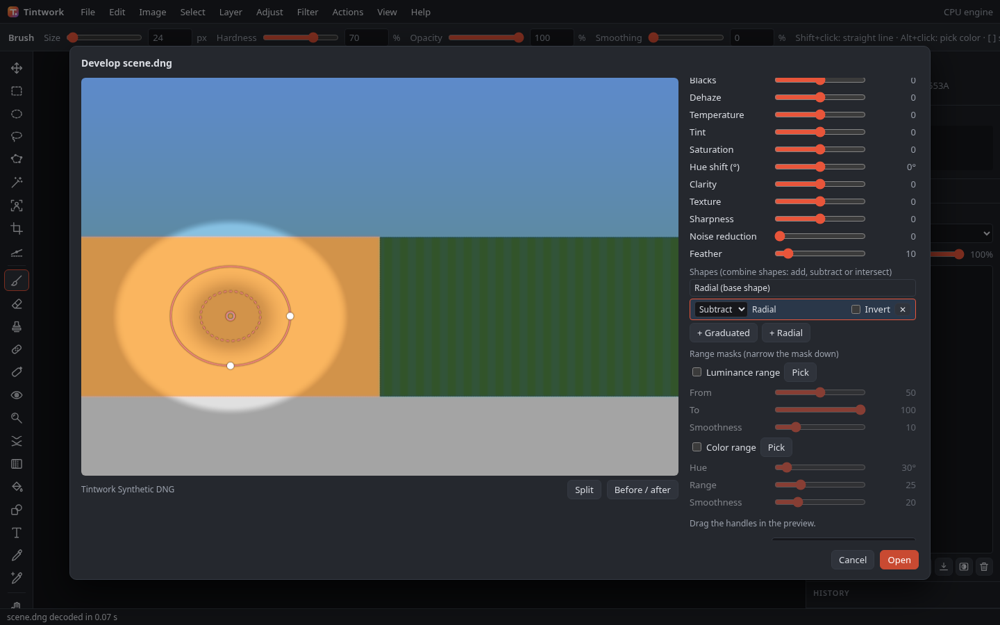

- **GPU RAW develop** (`src/gpu-develop.js`):
  - **WebGPU compute** shaders run the whole develop in float32. That covers white balance, the colour matrix, highlight recovery, tone and curves, vibrance and saturation, lens corrections, distortion, CA and every local mask, as well as the neighbourhood filters (colour and luminance NR, sharpening, defringe, local Clarity, Texture, Sharpness and Noise). Output is 16-bit, or 8-bit for previews.
  - Full-resolution develops run in bands with the same halo as the CPU workers.
  - The **WebGL2** fallback runs the per-pixel develop in a fragment shader into RGBA32F or RGBA16F targets, and the filters run on the CPU. Full-resolution WebGL2 develops use the CPU band workers.
  - The CPU band workers stay as the reference and as the fallback when a device is lost.
  - **Automatic** picks WebGPU, then WebGL2, then the CPU, and rejects software adapters such as SwiftShader, which are slower than the 7 CPU workers.
  - View ▸ Rendering engine has a **RAW develop engine** select (Automatic, WebGPU, WebGL2 or CPU), stored in `localStorage` `tintwork.devEngine`. The dialog's timing label shows `preview|draft N ms · Engine`.
- **CPU parity**: `scripts/lib/gpu-parity.mjs` develops the same synthetic scenes on the CPU and on each GPU engine.
  - Develop stage: within **1 level in 16 bits** on all 7 cases, on both engines.
  - Each filter on its own: ≤ 1 level (WebGL2: 0).
  - Every filter chained: 99.95% of values within 1 level, max 6 (WebGPU) or 5 (WebGL2), at filter edges where a 1-level input difference is amplified.
  - Dialog previews: GPU vs CPU max 1 in 8-bit.
  - 8-bit stores now round once: Uint8ClampedArray already rounds, so the old +0.5 is gone. This makes 8-bit previews about 0.5 level darker, which is the correct value.
- **Live preview while dragging and painting**:
  - Sliders, handle drags and brush strokes re-render before mouse-up; paint updates are throttled to 16 ms.
  - The brush raster is incremental. `cachedRaster` adds only the new strokes: 150 strokes take 110–170 ms from scratch, then 9–12 ms per added stroke.
  - When the last full preview took more than 45 ms, drags render a half-size **draft** (700 px). The full preview follows 180 ms after the input rests.
- **Add / Subtract / Intersect mask shapes**: each mask can hold up to 8 extra graduated or radial parts (`local[i].parts`), with `op` set to add (max), subtract (w·(1−q)) or intersect (w·q), plus a per-part invert.
  - The order is the shape, then the strokes, then the parts, then the mask invert, then the range masks.
  - The parts are listed under **Shapes**. Their handles are drawn green, red or yellow by operation.
  - Presets, re-develop and project files keep them.
- **More local controls**: **Whites** (up to ±0.9 EV, weighted to the brightest tones) and **Blacks** (a linear offset that fades out above the darkest 10%), **Dehaze** (removes a haze veil estimated from the darkest channel per pixel; negative values blend toward a haze colour) and **Hue shift** (±180°, a rotation around the grey axis that keeps luminance, so greys stay grey). They run on the CPU and both GPU engines.
- **Develop benchmark**: Help ▸ Run performance benchmark has an **include the RAW develop tests** option, which times on each engine:
  - a slider-drag preview and a brush-paint preview, both at 1.3 MP with 3 masks;
  - full-resolution 16-bit develops at each selected size (1, 12, 24 MP) with 3 masks, colour NR and sharpening.
  
  Software GPUs are labelled in the results.
- **Timings on this box (SwiftShader software GPU, not representative of real GPUs)**: CPU (7 workers) / WebGL2 / WebGPU.
  - Drag preview: 236 / 546 / 743 ms.
  - Paint preview: 200 / 444 / 733 ms.
  - Full 16-bit at 12 MP: 1.40 s CPU vs 7.6 s WebGPU.
  - Full 16-bit at 24 MP: 2.19 s CPU vs 17.7 s WebGPU.
  
  The < 50 ms preview target on real GPUs could not be verified here.
- Tests: `npm run test:v16` (33 checks, about 2 min):
  - Node: part combine maths, the new controls, bands vs whole image.
  - Browser, with WebGPU and SwiftShader: stage-by-stage and filter-by-filter GPU parity on both engines; GPU vs CPU dialog previews; the shapes UI by mouse; live paint and slider drafts; the incremental raster; the engine select; the benchmark rows.
  - Screenshots: `16a-raw-mask-shapes.png`, `16b-benchmark-raw-develop.png`.

## What's new in v1.5 (local adjustment masks: brush, range masks, more local controls, mask list and overlay)

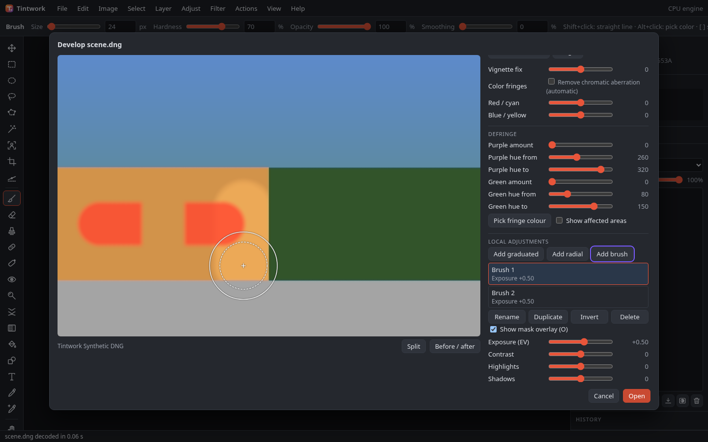

- **Brush masks**: **Add brush** (or `B`) paints a mask with the mouse. Size (% of the long side), Feather, Flow and Smoothing are remembered (`localStorage` `tintwork.rawBrush`); `[` / `]` change the size by ×1.2, and holding `Alt` (or **Erase**) erases. The cursor on the overlay canvas shows the outer radius, a dashed feather ring and + or −. Smoothing is a lag filter on coalesced pointer events (k = 1 − 0.9·smooth/100) with a minimum spacing and the last point forced on pointer-up, which removes mouse jitter. Strokes are stored in output fractions (up to 400 per mask, 4000 points per stroke) and rasterised in each worker to a grid of up to 768 cells on the long side, with a bbox and a cache keyed by a hash of the strokes. Flow builds up (`1 − (1 − w)(1 − flow·f)`), and erase strokes multiply by `1 − e`.
- **Auto mask (edge aware)**: each stroke takes reference colours from the preview under its points. Every output pixel inside the stroke is weighted by its similarity to the nearest reference in log₂ luminance and chroma, so paint stops at edges of colour or brightness.
- **Luminance and colour range masks**: any graduated, radial or brush mask can be narrowed by a luminance range (From/To/Smoothness on a 0–100 perceptual scale) and/or a colour range (Hue ± Range with Smoothness, weighted by saturation so greys are left alone). The **Pick** eyedroppers read the preview in the codec worker (`rawRange`): luminance sets ±15 around the spot, colour sets its hue and refuses near-grey spots. Ranges multiply with the shape, so they intersect.
- **More local controls**: Exposure, Contrast, Highlights, Shadows, Temperature, Tint, Saturation, Clarity, Texture, Sharpness and Noise reduction. Tone controls run per pixel in the develop pass; Clarity (12 px, two box passes), Texture (3 px), Sharpness (1-2-1) and Noise (2 px, with coring) run in a post pass that reads the weighted Int8 maps. Band develops still equal the whole-image develop exactly (max difference 0 with every feature on, BAND_HALO 48).
- **Mask list and overlay**: a list of masks with summaries; select, rename (double-click, **Rename** or `F2`; `Enter` keeps, `Esc` cancels), **Duplicate**, **Invert** and **Delete**. **Show mask overlay** (`O`) tints the selected mask's final weight (shape × ranges × auto mask) red at 60% on the preview. It is a preview-only flag and is never saved.
- **Cost per mask** (`npm run test:v15` prints both tables):
  - 24 MP ARW in the app, 7 band workers, best of 3: baseline develop 795 ms (1.89 s from Open to image). A radial mask adds +25 ms, a brush with auto mask +220 ms, a radial with Clarity +305 ms, and 8 masks with every control +1.92 s.
  - Node, one thread, 6 MP: baseline 730 ms. Graduated +253 ms, radial +222 ms, brush +404 ms, brush with auto mask +255 ms, luminance range +328 ms, colour range +351 ms, highlights + shadows +184 ms, clarity +440 ms, texture +380 ms, sharpness +301 ms, noise +314 ms; 8 masks with every control +2.2 s (about 30–70 ns per pixel per mask, 369 ns for all 8). Single-run timings vary by about ±100 ms on this box.
- Tests: `npm run test:v15` (40 checks):
  - Node: validation of the new fields; brush weights, flow, erase and invert; the auto mask stopping at an edge; luminance and colour ranges and their intersection with shapes and brushes; the range sampler; each new control's effect and zero-amount no-ops; 6 bands vs whole image; the overlay map.
  - Browser (synthetic 900×600 DNG: sky, orange wall, dark green, grey road): add brush and the cursor; paint with smoothing; Alt erase; `[` `]`; auto mask; `O`; rename by double-click, duplicate, invert and delete; colour and luminance eyedroppers; saturation; Open, re-develop keeps the list, project save.
  - Timings: the Node table and the 24 MP table above (`SKIP_BIG=1` skips the 24 MP part).
  - Screenshots: `15a-raw-brush-mask-overlay.png`, `15b-raw-brush-range-controls.png`.

## What's new in v1.4 (re-develop through transforms, linked RAW, local adjustments, distortion, defringe picker)

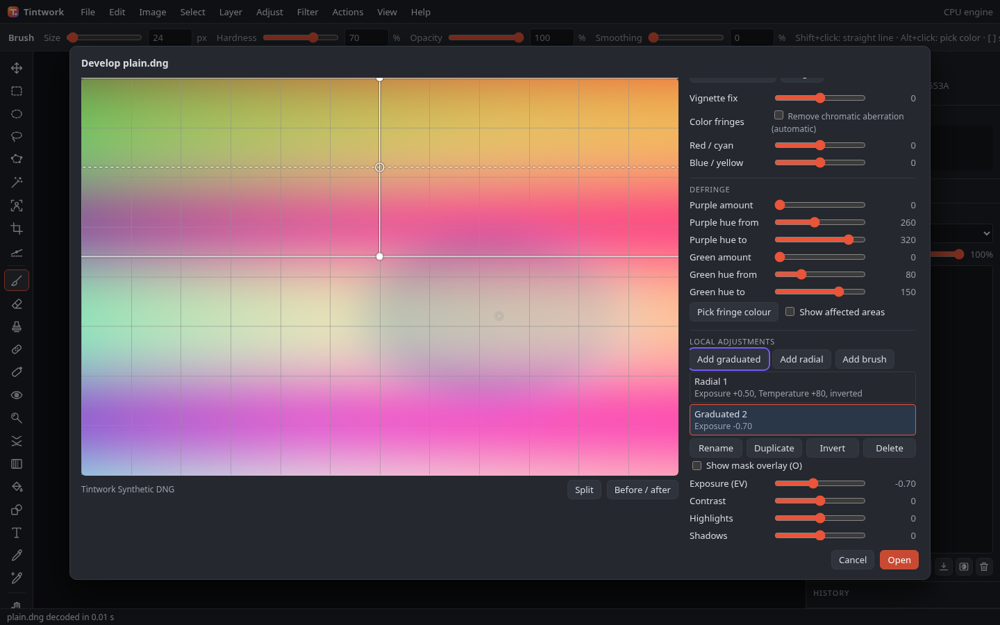

- **Re-develop after resize, rotate, flip, straighten and free transform**: a RAW layer keeps an affine map from its pixels to the developed image (`layer.raw.m`, `{a,b,c,d,e,f}`). Crops, image resizes, 90° rotations, flips, straighten and free transforms (single layers and multi-layer or group transforms) compose into it. Re-develop sends the map to the develop worker, which resamples the fresh 16-bit develop into the layer's current size. Quarter turns, flips and integer shifts are copied exactly. Other maps use bilinear sampling, with an integer box pre-shrink when the map reduces the image by more than 1.33×. In the test, a re-develop matches the transformed layer within 1 level (max) and 0.2 levels (mean). Transforming *selected pixels* is not tracked: the layer is marked and re-develop explains why it is refused.
- **Linked RAW files**: the develop dialog's **RAW file** choice is *Embed in the project* (the default) or *Link to the file on disk*. Linking is available for files opened through File System Access (Open, Open recent, drag and drop) in Chrome or Edge. The `FileSystemFileHandle` is stored in IndexedDB (`tintwork-links`). Project files (format **v8**) and autosave store only `{id, name, size, lastModified}`. If the handle is missing (another computer or browser), the file was moved or deleted, permission was refused, or the file is unreadable, a **Linked RAW file not found** prompt names the file and offers **Locate file…**. It warns when the name or size differs from the original. Layer ▸ **Embed linked RAW file** converts a linked layer to an embedded one. The last choice is remembered.
- **Defringe eyedropper and mask**: **Pick fringe colour** (`I`) reads the most saturated pixel near the click from a defringe-free preview in the worker. It sets the purple (200–340°) or green (40–190°) range to the hue ±20° (at least 10° wide), and an amount of 50 if the amount was 0. Neutral spots and non-fringe hues are refused with a message. **Show affected areas** renders the defringe weight as a mask (white = untouched, darker and tinted = colour removed). It is a view flag only and is never saved.
- **Manual lens distortion without a lens database**: a **Distortion** slider (±100) applies Tintwork's own one-term radial model, r' = r·(1 + k·r²)/n, with k = −slider × 0.0015 and r = 1 at the corners. The normaliser n keeps the frame filled. The dialog shows the lens name and focal length from EXIF, and a **grid** overlay (`G`) for lining up straight edges. **Save for this lens** stores the value as the user's own profile, keyed by EXIF lens model (or camera body for fixed-lens cameras) and focal length, in `localStorage` (`tintwork.lensProfiles`). Profiles are interpolated between saved focal lengths and applied on open and in batch. No third-party lens data is shipped: the lensfun database is CC BY-SA, so it is not used.
- **Local adjustments in develop**: graduated (linear) and radial filters, up to 8, each with Exposure (±4 EV), Contrast and Temperature (±0.5 EV red against blue). The radial filter also has Feather and Invert. Handles are dragged on a canvas overlay over the preview. `Delete` removes the selected filter and `Esc` deselects. Weights are computed per output pixel in the band workers: exposure and temperature in linear light after white balance, contrast around mid grey after the tone curve. A graduated filter fades at right angles to its line in image pixels. Band develops equal the whole-image develop. The filters are stored in the develop settings, so presets, the last-used settings and re-develop keep them.
- Tests: `npm run test:v14` (52 checks):
  - Node: local adjustment validation, weights and effects; bands vs whole image with filters, distortion and defringe; distortion fill and lens-profile interpolation; eyedropper hue picking; the mask; affine resampling.
  - Browser: grid, distortion and lens profiles (dialog and batch); the eyedropper by mouse; the mask; graduated and radial filters added, dragged, edited and deleted; re-develop after rotate, flip, resize and free transform; refusal after a selection transform.
  - Linked RAW, using OPFS handles as stand-ins for disk files: link, project v8, the handle found again from IndexedDB, the relink prompt after the file is removed, Locate, Cancel, and Embed.
  - Screenshots: `14x-raw-local-adjustments.png`, `14x-raw-defringe-mask.png`.

## What's new in v1.3 (re-developable RAW, split view, defringe, threaded decode)

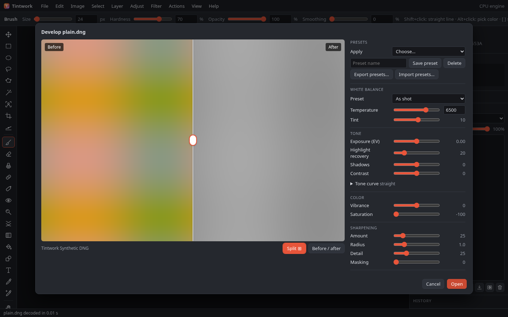

- **Re-developable RAW layers**: a developed layer keeps the original RAW file (as an immutable `Blob`) and its develop settings in `layer.raw`. It shows a **RAW** badge in the Layers panel. Double-clicking the thumbnail, the context menu or Layer ▸ Re-develop RAW… reopens the develop dialog with those settings ("Re-develop *name*", **Apply**). Apply re-develops from the RAW data in full 16-bit quality, replacing the layer pixels as a single undo step. Crops are tracked (the crop window is developed). A layer that was edited after developing asks for confirmation first, and a resized or rotated layer is refused with a message. Project files (format **v7**) embed the RAW file as a data URL. Autosave stores it once per document as an `R-` blob record, for files up to 200 MB. Screenshot: `13x-raw-redevelop.png`.
- **Split before/after view**: the **Split** button or `Y` shows *before* (the defaults, or the layer's previous settings when re-developing) on the left and the edit on the right. The divider can be dragged with the mouse or moved with the arrow keys. Edits redraw only the after side. `\` still toggles a full before view.
- **Preset files**: **Export presets…** writes `tintwork-develop-presets.json` (`{"format":"tintwork-raw-presets","version":1,"presets":[…]}`). **Import presets…** accepts that file, a bare array or a single preset. Settings are cleaned (clamped, with unknown keys dropped), names are de-duplicated case-insensitively, and files that are not preset files are refused with a message.
- **Defringe** (axial or purple fringing): **Purple amount** with a hue range (default 260–320°), and **Green amount** with a hue range (default 80–150°). Pixels are desaturated toward their luminance, weighted by hue (15° feather) and by local edge contrast, so flat purple or green objects are kept. This runs after noise reduction and before sharpening, in every band worker. Cost: about 0.23 s per 4 MP on one core, and nothing when the amounts are 0.
- **Threaded decode when cross-origin isolated**: when `crossOriginIsolated` is true (COOP `same-origin` + COEP `require-corp`), the codec worker loads FlashRaw's SIMD+threads build with `min(8, max(2, cores))` threads. Otherwise it falls back to the single-threaded SIMD build. The choice is reported in `window.tintwork.lastDecoder`. The new **`_headers`** file sets these headers for Netlify and Cloudflare Pages. `npm run serve:isolated` serves locally with them. GitHub Pages cannot set headers, so it gets the single-threaded decoder.
- **Memory-aware develop plan**: the develop pool is capped at `floor(navigator.deviceMemory × 1.5)` workers (8 GB is assumed when unknown), and bands are sized so that the bands in flight stay within 1/8 of device memory, with at most 25 % halo overhead. For 24 MP: 8 GB → 7 workers × 7 bands, 4 GB → 5 × 10, 2 GB → 2 × 10, 1 GB → 1 × 7.
- **Timing and memory**, 24 MP Sony ARW, headless Chromium, 8-core Linux box (`npm run mem:raw`; renderer PSS above idle):

  | | Decode | Open → full image | Develop peak | Whole-open peak |
  |---|---|---|---|---|
  | Not isolated (single-thread decode) | 0.61–0.90 s | 1.3–1.6 s | 0.83–1.20 GB | 1.36–1.73 GB |
  | Isolated (8 decoder threads) | 0.27–0.49 s | 1.3–1.6 s | 0.74–0.81 GB | 1.30–1.37 GB |

  About 0.6 GB of the peak is the fixed base (the decoded mosaic, the 16-bit result and the canvas). The rest scales with the number of bands in flight. The numbers vary by ±15 % between runs.
- Tests: `npm run test:v13` (44 checks): defringe unit and preview tests, the split view with mouse drag and keys, preset export/import and refusal of bad files, re-develop (double-click, Apply, undo, crop, edited-layer confirmation), project v7 and autosave round trips, `_headers`, isolated vs non-isolated decoder selection, 24 MP decode timing, and the `deviceMemory` caps. The older suites were updated only for project v7 and the larger dialog.

## What's new in v1.2 (faster RAW develop, more develop controls, presets)

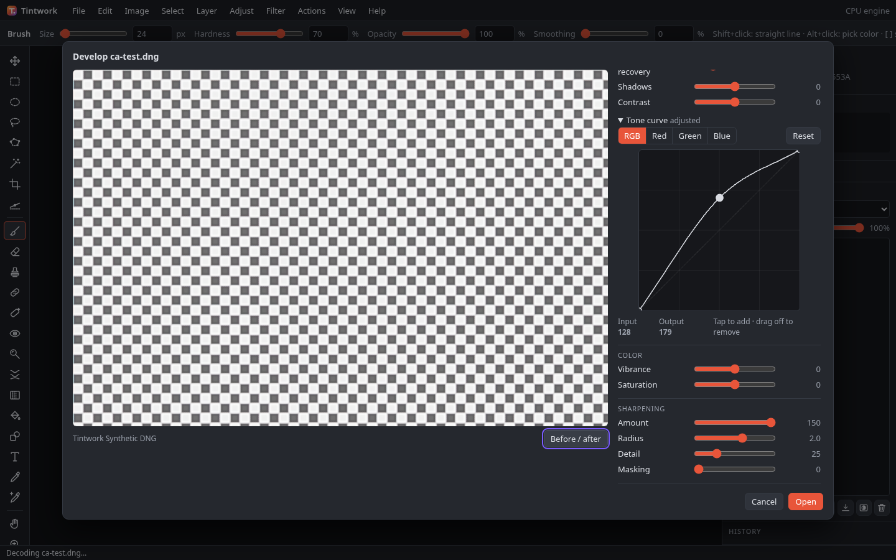

- **Parallel, progressive RAW develop**: the full-resolution develop is split into row bands (with a 48-row overlap so filters see their neighbours) and runs on a pool of nested Web Workers (`min(8, cores − 1)`; it falls back to one thread without nested workers). Bands are bit-identical to a single-thread develop (tested). **Open** closes the dialog at once, paints a half-resolution pass band by band (about 0.3 s after Open for 24 MP), then swaps in the 16-bit document (screenshot `12x-raw-progressive.png`).
- **Timing**, 24 MP Sony ARW, headless Chromium on this 8-core Linux box. Both builds were measured with the same script, interleaved, as the median of 10 runs each:

  | | v1.1.0 | v1.2.0 |
  |---|---|---|
  | File → develop dialog | 1.06 s | 1.08 s |
  | **Open → full 16-bit image on screen** | **3.3 s** | **1.3 s** |
  | Open → first preview | (none) | 0.3 s (half resolution) |
  | Total | ~4.4 s | ~2.4 s |

  Worker time for the full develop went from about 3.1 s to about 1.05 s. The other sample cameras now take 1.8–2.8 s end to end (2.3–4.6 s in v1.1). The file → dialog phase is still dominated by the single-threaded decode (~0.6 s).
- **New develop controls**: **tone curve** (RGB plus red, green and blue curves, using the same point editor as Curves); **vibrance** and **saturation**; **sharpening** (amount, radius, detail and masking: an unsharp mask on luminance with a halo limiter and an edge mask); **chromatic aberration**, which is automatic lateral CA (radial red and blue scale, estimated from high-contrast edges toward the corners) plus manual **red/cyan** and **blue/yellow** sliders; and a **Before / after** toggle (button or `\`).
- **Presets**: save, apply and delete named develop presets in the dialog (stored in `localStorage`). File ▸ Batch process has a **RAW files develop with** setting: last used, defaults, or any preset. Only an interactive Open changes "last used".
- **Offline RAW**: the service worker (cache `tintwork-shell-v1.2.0`) now pre-caches the FlashRaw wasm (SIMD and fallback builds) and the develop worker at install, so RAW opens offline before the first RAW file has ever been opened. The optional JPEG XL build is cached on a best-effort basis.
- New code: `src/develop-worker.js` (band worker). `src/raw.js` gains `developRows`, `planBands`, `extractRegion`, `halveRegion`, `sharpen`, `estimateCA`, `caScales` and `cleanSettings`, and its box blur is faster.
- Tests: `npm run test:v12` (35 checks): band develop equals single-thread, half-res tiling, sharpening/vibrance/saturation/curve/CA unit tests, offline pre-cache with an offline reload, every new dialog control with the mouse, presets, progressive Open, batch with defaults, a preset and last used, and the 24 MP timing. The v1.1 24 MP limit was tightened from 9 s to 5 s.

## What's new in v1.1 (camera RAW and layered PSD)

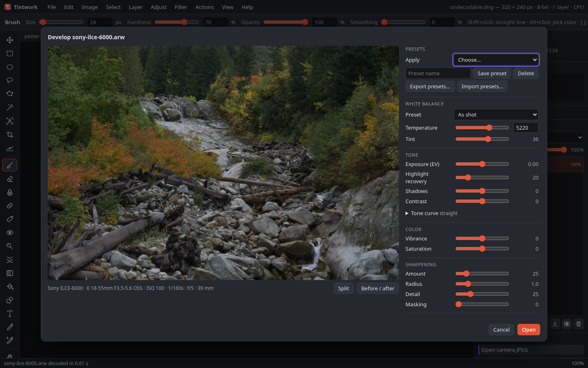

- **Camera RAW**: open DNG, CR2, CR3, NEF, ARW, RAF, ORF and RW2 (plus other formats the decoder recognises: PEF, SRW, 3FR, IIQ, X3F, ERF, MEF, MOS, MRW, NRW, SR2, SRF, KDC, DCR, RWL, CRW, FFF) through File ▸ Open, drag and drop, Open recent, batch, or Windows file associations once the PWA is installed. A **Develop** dialog shows a live preview with white balance (as shot, auto, custom temperature/tint), exposure, highlight recovery, shadows, contrast, luminance and colour noise reduction, and lens correction (distortion and vignetting from DNG opcodes, on/off) plus a manual vignette slider. **Open** develops into a 16 bits/channel document. Decoding and developing run in a Web Worker.
- **RAW fallback**: if the sensor data cannot be decoded, the camera's embedded JPEG opens instead with a clear notice (also available on demand as **Use camera JPEG**). If the container itself cannot be parsed, Tintwork scans the file for the largest complete embedded JPEG.
- **PSD/PSB import**: layers, names, opacity, visibility, blend modes, groups (with pass-through), clipping, layer and group masks, matching adjustment layers (brightness/contrast, levels, curves, exposure, hue/saturation, invert), 8- and 16-bit. Text, smart objects and fill/shape layers are rasterized from their stored pixels, effects are dropped, and unsupported blend modes or adjustments are approximated or skipped; a notice lists every conversion (screenshot `11x-psd-import-notes.png`). Unreadable layer data falls back to the flattened composite.
- **PSD export** (File ▸ Export layered PSD…, PSD in the Export dialog and in batch): layers, groups, masks, clipping, blend modes, opacity, matching adjustment layers and a composite, 8- or 16-bit. Layer styles are baked into pixels; LUT and white-balance layers are skipped with a notice (screenshot `11x-psd-layers.png`).
- **Timing** (headless Chromium, CPU, this Linux box, single worker): a 24 MP Sony ARW opens to the develop dialog in about 0.9 s and to the full 16-bit document on screen in about 3 s after **Open** (total about 4 s: decode ~0.55 s, develop ~1.1 s, colour noise reduction ~1.2 s, canvas ~0.3 s). Every sample camera (9 files, 16–24 MP) opens in 2.3–4.6 s.
- New code: `src/psd.js` (PSD/PSB reader and writer, original), `src/raw.js` (develop pipeline, original), `src/codec-worker.js` and `src/codecs.js` (worker and client). RAW decoding uses the vendored **FlashRaw 0.1.0** WebAssembly decoder (MIT OR Apache-2.0, `vendor/flashraw/`, licence files included).
- Tests: `npm run test:v11` (PSD round trips against an independent writer, a synthesized lens-corrected DNG, the JPEG fallback, per-format decode and the 24 MP timing). Run `npm run fetch-raw` once to download the CC0 sample RAW files (about 185 MB, git-ignored); without them the sample checks are skipped.

## What's new in v1.0 ("core complete")

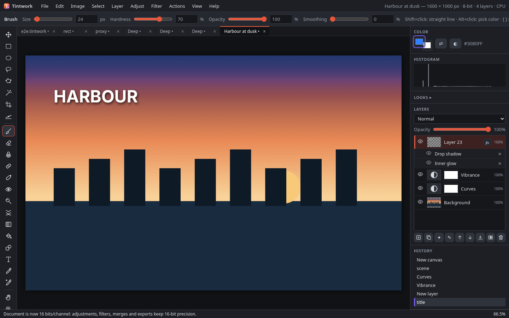

- **Welcome screen**: open, new canvas, recent files (Chrome/Edge) and one-click size presets (Full HD, square, 4:5, A4 300 ppi, 24 MP) whenever no document is open (screenshot `10x-welcome.png`).
- **User guide**: [docs/USER_GUIDE.md](docs/USER_GUIDE.md), also built into the app as Help ▸ User guide (**F1**) with a contents bar; it works offline (screenshot `10x-user-guide.png`). After editing the guide run `npm run guide` to refresh `src/user-guide.js` (a test checks they match).
- **Error handling**: any uncaught error or rejected promise shows a short, friendly notice and autosaves the current document immediately, so a reload can restore it. Damaged or unreadable files are reported by name and nothing else changes.
- **Memory guardrails**: New canvas, Image size and Open estimate the memory a document needs (pixels × layers, more for 16-bit) against what the browser allows. Large documents get a warning; documents that would not fit are refused, and an image too large to open is offered scaled down.
- **Accessibility basics**: every control has an accessible name (icon buttons take their tooltip), a visible keyboard focus outline everywhere, and muted text raised to 6.3:1 contrast.
- **Faster on 24 MP photos (CPU path)**: brush strokes now recomposite only the dirty rectangle (742 → ~85 ms per mouse move); adjustment-layer sliders show a 2 MP preview while dragging and sharpen when you stop (760 → ~335 ms per step); unadjusted adjustment layers copy straight into the composite, and big layers are drawn only over their painted bounds. Measure with `node scripts/perf.mjs [cpu|gpu|webgpu]`; numbers are in `docs/perf-before.json` and `docs/perf-after.json`. GPU numbers from this box are software (SwiftShader) and not representative; run Help ▸ Run performance benchmark on real hardware.
- **16-bit layer styles**: inner glow, inner shadow and colour overlay are now computed in float in 16-bit documents (separable blend modes), like drop shadow, outer glow and stroke.
- Fixed: after dragging an adjustment-layer slider on a large document the full-resolution result could fail to replace the preview.

## What's new in v0.9 (documents, presets, batch export, actions)

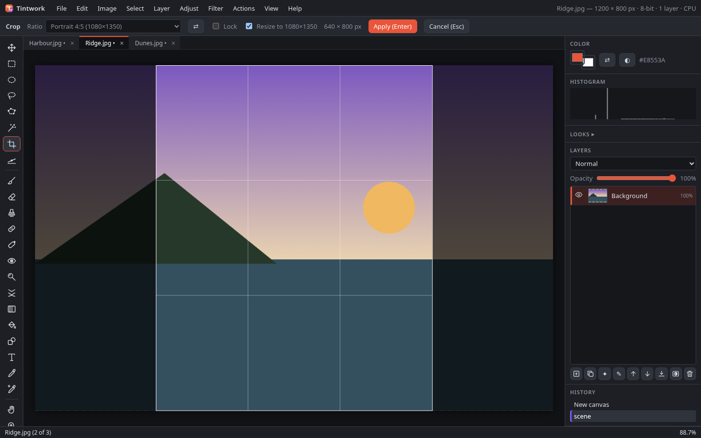

- **Document tabs**: every opened or new image gets a tab above the canvas with its own undo history, zoom and autosave slot. **Ctrl+Tab** / **Ctrl+Shift+Tab** (also Ctrl+F6) switch, **Ctrl+Alt+W** closes, middle-click closes a tab. Closing a document with unsaved changes asks first. Open several files at once from File ▸ Open.
- **Copy layers between documents**: drag a layer from the Layers panel onto another tab, or Layer ▸ Duplicate to document…; it lands centred (16-bit data is kept when the target is 16-bit).
- **Crop presets**: the Crop tool bar has social (1:1, 4:5, 9:16, 16:9, 1.91:1), banner and print (4×6, 5×7, 8×10 in, A4 at a DPI you pick) sizes, free ratios, an orientation swap, a ratio lock and "resize to preset". **Image ▸ Resize to preset…** crops to fill or fits inside; save your own presets there. Crop + resize is one undo step, and print sizes write their DPI into exported JPEG/PNG files.
- **Export multiple sizes** (File ▸ Export multiple sizes…): one click exports any mix of original, long edge, width, scale % and preset sizes as JPEG, PNG or WebP, named by a pattern (`{name}`, `{w}`, `{h}`, `{preset}`, `{n:3}`, `{N}`, `{ext}`, `{date}`), into a folder (Chrome/Edge folder access) or a ZIP. A progress bar has Cancel.
- **Actions** (new Actions menu): Record, Stop and replay adjustments, filters, rotate/flip, crop and resize presets, looks, auto fixes and image size. Three built-in actions; import/export as JSON (screenshot `9x-actions.png`).
- **Batch** (File ▸ Batch process…): pick a folder (optionally with subfolders) or files, an action and/or a look, and output sizes; each image opens in a temporary tab, is processed, exported and closed. Shows progress, can be cancelled, and lists files that failed (screenshot `9x-batch-dialog.png`).
- **v0.8 gaps closed**: 3D LUT layers now render on WebGL2 and WebGPU; drop shadow, outer glow and stroke pixels stay 16-bit in 16-bit documents; Image ▸ Auto enhance options… (which fixes, strength) and Auto white balance options… (strength, warmth).

## What's new in v0.8 (core structure, automatic tools, looks)

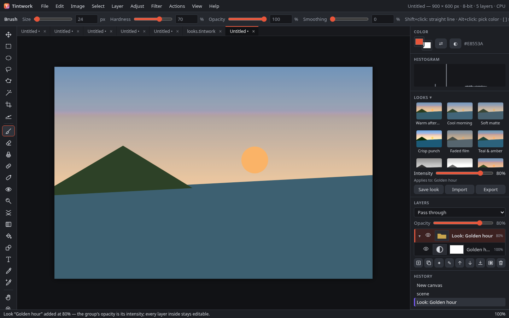

- **Multi-layer selection**: Ctrl+click toggles layers and Shift+click selects a range. The Move tool, arrow-key nudge, free transform (Ctrl+T), Group (Ctrl+G) and Delete work on all of them. Layer menu ▸ **Align** (left, centres, right, top, middle, bottom) and **Distribute** (horizontal or vertical centres, 3+ layers) (screenshot `8x-multi-select-align.png`).
- **Free transform on groups**: Ctrl+T on a group transforms everything in it (and the masks) as one box.
- **True pass-through groups** with opacity or a mask on the CPU, WebGL2 and WebGPU engines (they used to be rendered isolated).
- **16-bit everywhere it matters**: groups composite in float, styled layers keep their 16-bit pixels where the effects don't touch them, and warp, perspective, liquify and straighten resample the 16-bit data. Also fixes a rounding mismatch that dropped about half of a 16-bit layer's pixels to 8-bit whenever the layer was touched.
- **Auto enhance** (Image ▸ Auto enhance, **Ctrl+Shift+L**): adds an editable "Auto enhance" group with only the steps the picture needs: white balance, levels, a gentle S-curve and saturation.
- **White balance**: a temperature/tint adjustment (Adjust menu or adjustment layer, every engine), **Auto white balance** (gray-world), and a **white balance picker** tool: click something that should be grey or white.
- **Straighten**: a Straighten tool (draw along the horizon or a vertical) and **Auto straighten** (Hough transform on the picture's edges). Both optionally crop to the largest clean rectangle with the same aspect (screenshots `8x-straighten-tool.png`, `8x-straightened.png`).
- **Looks panel**: 12 original looks made only of adjustment layers. Each one is added as an editable group, and the **Intensity** slider is the group's opacity. **Save look** stores a group (or the selected adjustment layers) as your own look; **Import/Export** use JSON files. Right-click one of your looks to delete it.
- **3D LUTs**: Layer ▸ New adjustment layer ▸ 3D LUT from .cube file, with an Amount control. The table is saved in the project.

## What's new in v0.7 (layers structure, warping, benchmark)

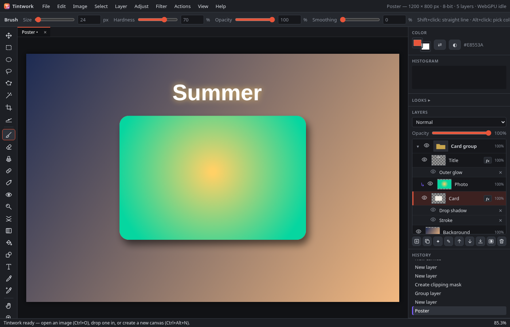

- **Layer groups**: nested groups (Layer ▸ New group, **Ctrl+G** to group the active layer, **Ctrl+Shift+G** to ungroup). Groups can be collapsed and have their own opacity, blend mode and mask. The default mode is **Pass through**, which blends the children with the layers below; any other mode composites the group first. Groups are saved in projects (project format v6; older projects still open).
- **Clipping masks** (**Ctrl+Alt+G** or Layer ▸ Create / release clipping mask): a clipped layer shows only where the layer below it is opaque. Several clipped layers can share one base. The panel indents them and shows an arrow.
- **Layer styles** (Layer ▸ Layer style…, or click the **fx** badge): drop shadow, inner shadow, stroke (outside, inside or centre), outer glow, inner glow and colour overlay. Each effect has its own switch and settings, with a live preview; Cancel restores the old style. Effects are listed under the layer, where each can be hidden or removed. Styles are saved in projects and render the same on the CPU, WebGL2 and WebGPU (screenshot `7x-layer-styles-dialog.png`).
- **Warp and perspective** (Edit ▸ Warp / Edit ▸ Perspective): drag the corner handles (perspective) or a 3×3, 4×4 or 5×5 control-point grid (warp). A low-resolution preview follows the mouse; **Enter** applies and **Esc** cancels. The layer mask is warped along with the layer. The final render uses WebGPU or WebGL2 when available and falls back to the CPU (screenshot `7x-warp.png`).
- **Liquify tool (K)**: push, bloat, pinch and restore, with size and strength. It works directly on the canvas, with a fast preview while you drag, and each stroke is one undo step.
- **Built-in benchmark** (Help ▸ Run performance benchmark…): runs the same operations (Gaussian blur, curves, a 10-layer composite cold and warm, a mesh warp) on every available engine (CPU, WebGL2, WebGPU) at 12 and 24 MP (1 MP as a quick check) with synthetic images. The table marks the fastest engine and lists the adapter name and vendor, flagging software adapters as not representative. **Copy results** puts a plain-text report on the clipboard. Open documents are not touched (screenshot `7x-benchmark.png`).
- **Automatic engine choice** now runs a quick probe (1 MP blur, curves and composite on each engine) and picks the fastest, instead of a fixed rule. View ▸ Rendering engine… shows the probe times and can measure again.
- **16-bit fixes**: dodge/burn and red eye now compute and store 16 bits per channel in 16-bit documents (touched pixels used to drop to 8-bit).
- Fix: running the WebGPU engine check could wipe open layers in some GPU drivers (seen with SwiftShader); the presentation check now runs once per session and the benchmark never uses it.

## What's new in v0.6 (Windows desktop, Chrome and Edge first)

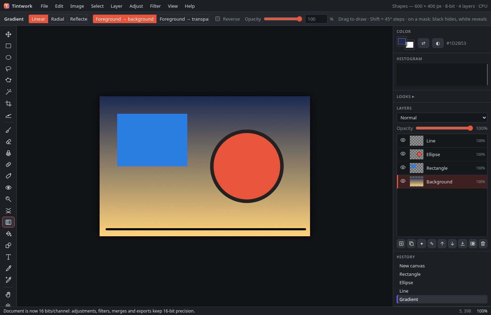

- **WebGPU compute engine** (`src/webgpu.js`) is now the main engine on Chrome and Edge. The order is WebGPU, then WebGL2, then CPU. **View ▸ Rendering engine…** offers Automatic, WebGPU, WebGL2 (GPU) or CPU and shows the adapter, its limits and memory use (screenshot `6x-engine-webgpu.png`).
  - It covers compositing (every blend mode, opacity, masks, adjustment layers), blur, curves/levels LUTs, hue/saturation and the other point adjustments, plus brush-dab stamping.
  - Pipelines are specialized per blend mode and operation (constants are baked in, which is about 3x faster than branching at runtime).
  - Blur uses a bilinear "paired-tap" gather shader, which halves the texture reads. It runs 4x faster than the v0.6 shared-memory version, and the output is identical.
  - On a real GPU, results go straight to the canvas. On software adapters (SwiftShader) they are read back instead. Automatic mode still chooses the CPU when the adapter is software or fails the speed probe.
- **File System Access** (Chrome/Edge): **Ctrl+S** saves in place, and the first save goes through Save As. **Ctrl+Shift+S** always asks where to save. Export uses the save picker. An opened JPEG/PNG is never overwritten by a project save. **File ▸ Open recent** keeps file handles in IndexedDB (screenshot `6x-open-recent.png`). Browsers without the API fall back to download and upload.
- **Installable app (PWA)**: window controls overlay, file handling (opening .png/.jpg/.webp/.tintwork from Explorer), app shortcuts (`?action=new`, `?action=open`) and an offline shell. The title bar shows the document name, with • when there are unsaved changes.
- **Mouse precision** (the essentials only):
  - a stroke stabilizer ("smoothing" 0–100, string model with catch-up);
  - **[ ]** brush size and **Shift+[ ]** hardness;
  - cursor-anchored wheel zoom;
  - right-click menus on the canvas and on layers (screenshot `6x-context-menu.png`).
- **New core tools**:
  - **Gradient (G)**: linear, radial or reflected; foreground→background or foreground→transparent; reverse and opacity. It respects soft selections. Shift snaps to 45°. On a mask it paints the mask. 8-bit output is dithered, and in a 16-bit document the gradient is computed at 16 bits.
  - **Shapes (U)**: rectangle, rounded rectangle, ellipse and line. Each can be fill, stroke or both, and each lands on its own new layer. Shift draws a square, circle or 45° line; Ctrl draws from the centre. A live preview shows while you drag (screenshot `6x-shape-preview.png`).
  - **Dodge / Burn (O)**: targets shadows, midtones or highlights with an exposure setting. Alt switches to the opposite mode.
  - **Red eye (J)**: click a pupil. The pupil size and darken amount are adjustable.
  - Pressing a tool key again cycles through the tools that share it: G gradient/fill, O ellipse select/dodge-burn, J spot heal/red eye.
- Fixes:
  - Opening a project now names the document after its file.
  - The window title is no longer overwritten.
  - Context-menu commands no longer run twice.

### v0.6 benchmarks (`npm run bench`, raw log in `docs/bench-v0.6.log`)

These were measured on the same Linux box with **no GPU**. Chromium's WebGPU adapter is **SwiftShader (software)** and uses readback output. WebGL2 is ANGLE on SwiftShader. These GPU numbers measure a CPU emulating a GPU, so they are **not representative of a real Windows GPU**. They do show that the WebGPU path is correct and how its cost scales. Automatic mode chooses the CPU path on this box. Times are in ms per operation, and the GPU columns include upload and readback.

| Operation (Chromium) | CPU / worker | WebGL2 (SwiftShader) | WebGPU (SwiftShader) |
|---|---|---|---|
| Gaussian blur 25 px, 12 MP | 2012 | 6291 | 6975 |
| Gaussian blur 25 px, 24 MP | 3385 | 13459 | 13000 |
| Curves, 12 MP | 72 | 299 | 443 |
| Curves, 24 MP | 130 | 633 | 1013 |
| 10-layer composite, 12 MP (cold / warm) | 549 / 301 | 4309 / 3549 | 6484 / 4115 |
| 10-layer composite, 24 MP (cold / warm) | 1134 / 615 | 9436 / 7175 | 12196 / 8030 |
| Large brush stroke, 12 MP | 384 | 410 (CPU path) | 3709 (async engine call) |
| Large brush stroke, 24 MP | 490 | 566 (CPU path) | 6479 (async engine call) |

GPU memory for the 10-layer composite: WebGL2 used 916 MB at 12 MP and 1831 MB at 24 MP; WebGPU used 1099 MB and 2197 MB.

Before the paired-tap shader, the WebGPU blur took 29,813 ms at 12 MP. The WebKit run (software GL, CPU fallback) is in the log.

## What's new in v0.5

- **GPU engine (WebGL2)** with an automatic CPU fallback. Layers, every blend mode, opacity, layer masks, adjustment layers and live filters are composited in half-float or float textures. Gaussian blur (separable), sharpen, noise, vignette, curves/levels (LUT textures), hue/saturation, exposure, brightness/contrast, invert, grayscale and sepia run as shaders.
  - **View ▸ Rendering engine…** offers Automatic, GPU or CPU, and shows the renderer, texture limits, GPU memory use and the speed-probe time. The status bar shows `GPU` or `CPU`.
  - Automatic mode uses the GPU only when it is real hardware and passes a 1 MP blur probe (≤ 40 ms). Software rasterizers such as SwiftShader or llvmpipe stay on the faster CPU/worker path.
  - The CPU path takes over, with a notice, when WebGL2 or float render targets are missing, when the GPU context is lost, or when a document exceeds the max texture size or the GPU memory budget (1.5 GB on desktop, 384 MB on iOS). Large images are drawn back in tiles (2048 px on iOS).
- **16 bits per channel**: Image ▸ Mode: 8 / 16 bits/channel. In 16-bit mode, layer pixels are stored as 16-bit and the canvas you see is an 8-bit proxy.
  - Adjustments, adjustment layers, merge down and flatten work at 16 bits. An optional setting runs blur and sharpen in linear light.
  - Opening a 16-bit PNG creates a 16-bit document. There is a **PNG 16-bit** export, and 8-bit exports of a 16-bit document are dithered.
  - Project files are now format v5 and store 16-bit layers as 16-bit PNG; v4 files still open. Autosave keeps the 16-bit data of the current step, up to 8 MP (4 MP on iOS).
  - The PNG codec is in `src/png.js` and uses the bundled [fflate](vendor/fflate/LICENSE) (MIT) for deflate.
- **Platform-aware keyboard**: Windows and Linux use Ctrl, Alt and Shift; macOS uses ⌘, ⌥ and ⇧. Menus, tooltips, hints and the shortcuts dialog show the right names for the platform.
  - Combinations the browser or OS keeps for itself (Ctrl+N, Ctrl+T, Ctrl+W, Ctrl+Shift+N, Ctrl+Shift+I/C on Windows; ⌘N, ⌘T, ⌘W, ⌘Q, ⌘M on Mac) get alternates: Ctrl+Alt+N new canvas, Ctrl+Alt+Shift+N new layer, Ctrl+Alt+T free transform, Shift+F7 invert selection, ⇧⌘M curves on Mac. The usual combination still works wherever the browser passes it on.
  - Ctrl+Y and Ctrl+Shift+Z both redo. You can force the platform with `?platform=win|mac`.
- **Comparison doc**: [docs/COMPARISON.md](docs/COMPARISON.md) compares each milestone's features with current paid editors, with sources.

### v0.5 benchmarks (`npm run bench`)

These were measured on this Linux box with **no GPU**. Headless Chromium renders WebGL2 with **SwiftShader**, a software emulation. Headless WebKit reports a masked "Apple GPU" but also renders in software (Mesa). So the GPU column measures a CPU pretending to be a GPU, and it is **not representative of real hardware**; on a real GPU these shaders are expected to be much faster. That is also why automatic mode picked the CPU path here. Times are in ms per operation, including texture upload and readback.

| Operation | Chromium GPU (SwiftShader) | Chromium CPU / worker | WebKit GPU (software) | WebKit CPU |
|---|---|---|---|---|
| Gaussian blur 25 px, 12 MP | 5907 | 1794 | 1569 | 1239 |
| Gaussian blur 25 px, 24 MP | 12092 | 3888 | 3389 | 2765 |
| Curves, 12 MP | 307 | 79 | 105 | 59 |
| Curves, 24 MP | 657 | 149 | 230 | 133 |
| 10-layer composite, 12 MP (cold / one layer changed) | 4627 / 3633 | 341 | 1935 / 445 | 366 |
| 10-layer composite, 24 MP (cold / one layer changed) | 9106 / 7582 | 1086 | 4138 / 981 | 585 |

GPU memory for the 10-layer composite was 916 MB at 12 MP and 2426 MB at 24 MP (half-float textures, budget raised to 4 GB for the benchmark).

**Banding** (a 4096 px ramp covering levels 100–140, stretched to the full range by a steep curve):

| Pipeline | Distinct output levels |
|---|---|
| 8-bit | 41 |
| 16-bit (internal) | 4062 |
| 16-bit result shown or exported at 8 bits | 256 |

The default dithered 8-bit export has a mean error of 0.33 levels.

## What's new in v0.4

- **Blend modes on adjustment layers**: an adjustment layer's blend mode (Multiply, Screen, Overlay, …) is honored together with its opacity and mask, both live and when it is merged down.
- **Live (non-destructive) filters**: Layer ▸ Convert to live layer (also in the Filter menu) keeps the original pixels. Gaussian blur, sharpen, noise and vignette then stack on top of them:
  - Every filter in the stack can be shown or hidden, re-edited (✎ or double-click in the Layers panel), reordered or deleted from the live filter panel (✎ on the layer).
  - A filter mask limits where the filters apply. You can make it from the selection, paint it (click its thumbnail), invert it or disable it (Shift+click).
  - The stack is saved in project files (format v4), undo restores it, and Layer ▸ Convert to pixels bakes it.
- **Free transform** (Edit ▸ Free transform, Ctrl+T, or Transform in the Move tool's bar), for layers and for selected pixels:
  - Corner and edge handles scale, Shift keeps the aspect ratio, dragging outside the box rotates (Shift snaps to 15°), and Ctrl+drag on a handle skews.
  - The options bar has numeric W/H %, angle and skew fields. Enter or Apply commits as one undo step; Esc or Cancel restores.
  - On a phone, two fingers scale, rotate and move the piece instead of the view.
  - Live layers transform their original pixels, so their filters re-render.
- **Autosave with history and recovery slots**: each document autosaves with its last 20 undo steps, and the 5 newest unsaved documents are kept. After a crash or reload the recovery prompt lists each one with its step count. Recovered documents can be undone straight away.
- **Select ▸ Color range…**: sampled color (click the canvas while the dialog is open) with fuzziness, hue presets (reds … magentas) and highlights/midtones/shadows. It has a live mask preview and combines with the selection mode.
- **Select ▸ Refine edge…** (Ctrl+Alt+R): smooth, feather and contract/expand, with a live preview of the selection.
- **Bundled open-licensed fonts** for text: Inter, Lora, Bebas Neue, Pacifico and JetBrains Mono (SIL OFL 1.1, Latin-subset WOFF2). They are served locally from `fonts/` with their licenses (see `fonts/README.md`) and cached for offline use.

## What's new in v0.3

- **Adjustment layers** (Layer ▸ New adjustment layer, or the ✦ button in the Layers panel): brightness/contrast, hue/saturation, exposure, levels, curves, invert and grayscale. They work non-destructively: each one re-renders the layers below it, and nothing is baked in. To change the settings, double-click the layer thumbnail or press ✎. Every adjustment layer has a mask. If a selection is active when you create one, the mask is made from that selection. Merge down bakes the adjustment into pixels.
- **Curves** with an interactive point editor (Adjust ▸ Curves…, Ctrl+M, or as an adjustment layer):
  - Composite RGB plus R, G and B tabs, drawn over a histogram, with a monotone smooth curve.
  - Click to add a point and drag it. Drag a point off the graph, double-click it or press Delete to remove it. Arrow keys nudge a point. Reset restores the curve and an In/Out readout shows the values.
- **Editable text layers**: to change the text, font, size, bold/italic, color or alignment, click the layer with the Text tool, double-click its thumbnail or press ✎. Changing the alignment keeps the text block in place. Painting, filters and transforms first ask to rasterize the layer, and Layer ▸ Rasterize does it manually.
- **Healing brush** (R; Alt+click sets the source) and **spot healing** (J): these match the texture from the source to the color and tone around the target.
- **Ellipse selection** (O; Shift/Alt/Shift+Alt add, subtract and intersect; Ctrl draws from the center).
- **Move selected pixels**: with a selection active, the Move tool lifts and moves just those pixels, and Alt+drag duplicates them. Arrow keys nudge.
- **Autosave and crash recovery**: about 1.5 s after each change, and when the page is hidden, the document is saved to IndexedDB (layers, masks, adjustment and text settings). After a crash or reload you get a "Recover unsaved work?" prompt. File ▸ Recover autosave… restores it manually.
- **Mobile / iPhone**: a touch layout with bottom sheets for tools, layers, history and adjustments.
  - Pinch to zoom, two-finger pan, and on-screen Shift/Alt/Ctrl modifier chips.
  - Sharing an export uses the Web Share API.
  - The app is an installable PWA with an offline service worker. iOS Safari is the main target.

## Features (v0.2)

**Files**
- Open an image via file picker (Ctrl+O), drag and drop, or paste from the clipboard
- New blank canvas with presets and white / background-color / transparent fill (Ctrl+N)
- Place an image as a new layer (Ctrl+Shift+O, or drop onto an open document; hold Shift while dropping to open instead)
- Export PNG, JPEG or WebP with a quality setting (Ctrl+Shift+E); JPEG is flattened onto white
- Save / load a project file (`*.tintwork.json`: JSON with one PNG data URL per layer, plus name, visibility, opacity, blend mode, offset and the layer mask with its enabled state). v0.1 projects still open.

**Layers**
- Add, delete, duplicate, rename (double-click), reorder (drag in the list or ▲/▼), merge down, flatten
- Visibility, opacity and 16 blend modes (Canvas `globalCompositeOperation`: multiply, screen, overlay, soft light, difference, hue, color, luminosity and more)
- Live thumbnails
- **Layer masks** (new in v0.2): add a mask that reveals everything or one made from the selection. Paint on it with the brush, eraser or fill: black hides, white reveals and grays are partial. The eraser always hides. Gaussian blur and invert also work on a mask. Click the mask thumbnail to edit the mask and the layer thumbnail to edit pixels (or press `\`). Shift+click the mask thumbnail to enable or disable it; a red X marks a disabled mask. Commands to apply (bake into alpha), invert and delete masks are in Layer ▸ mask commands. Masks follow transforms, crop, resize, duplicate and merge, and they are kept in undo history and project files.

**Tools** (left toolbar)
| Tool | Key | Notes |
|---|---|---|
| Move | V | Drag the active layer, or the selected pixels when there is a selection (Alt duplicates); arrow keys nudge (Shift = 10 px) |
| Rectangle select | M | Drag a rectangle |
| Lasso | L | Freehand outline |
| Polygonal lasso | P | Click points; close with double-click, Enter or a click on the start point; Backspace removes a point; Esc cancels |
| Magic wand | W | Selects by color with tolerance, contiguous or global, active layer or all layers; reuses the fill tool's flood-fill code |
| Crop | C | Drag, then Enter to apply / Esc to cancel |
| Brush | B | Size, hardness, opacity; Shift+click draws a straight line; Alt+click picks a color |
| Eraser | E | Size, hardness, opacity |
| Clone stamp | S | Alt+click sets the source, then paint to copy pixels. Size, hardness and opacity settings; aligned or non-aligned; a crosshair shows the source point |
| Fill | G | Tolerance, contiguous or global |
| Ellipse select | O | Drag an ellipse; Ctrl draws from the center |
| Healing brush / Spot healing | R / J | Alt+click sets the healing source; spot healing samples around the spot automatically |
| Text | T | Click to place, or click an existing text layer to edit it; font, size, bold/italic, color, alignment, live preview |
| Color picker | I | Sample the merged image or the current layer |
| Hand / Zoom | H / Z | Also: hold Space to pan, mouse wheel to zoom at the cursor, middle-drag to pan |

**Selections** (new in v0.2): selections are 8-bit masks, so they can have soft edges.
- Every selection tool has New, Add, Subtract and Intersect modes. Pick one in the options bar, or hold Shift to add, Alt to subtract, or Shift+Alt to intersect.
- The Select menu has All (Ctrl+A), Deselect (Ctrl+D), Invert (Ctrl+Shift+I), Feather… (Shift+F6, a Gaussian blur of the mask), Select layer pixels (from alpha) and Crop to selection.
- Animated marching ants trace the actual mask outline.
- The selection limits brush, eraser and clone strokes, Fill, Clear, Fill with color, Copy, and every adjustment and filter. Soft (feathered) selections blend partially.

**Image / transform**: rotate 90° CW / CCW / 180°, flip horizontal / vertical (whole image or a single layer), image size (resample with proportional lock), canvas size (9-point anchor), crop to selection.

**Adjustments** (live preview, then OK to apply or Cancel to revert; applied to the selection when there is one)
- Brightness / contrast, Hue / saturation / lightness, Exposure (EV, offset, gamma)
- Levels with a histogram (input black / white, midtone gamma, output range), Auto levels
- Invert, Grayscale, Sepia tone

**Filters**: Gaussian blur (3-pass box approximation with premultiplied alpha), Sharpen (unsharp mask with threshold), Add noise (mono or color), Vignette (darken or lighten edges, size, feather).

**Background processing** (new in v0.2): adjustments, filters and feathering run in a module Web Worker (`src/worker.js`) using transferable buffers.
- Previews are coalesced, so only the latest slider value is processed. The status bar shows "Processing…" while a job is running.
- If module workers are unavailable, the same code runs on the main thread instead.
- In the test, a 25 px blur of a 4000×3000 image blocks the page for about 1.6 s when run inline. Through the worker, the longest UI stall was about 0.1 s.

**History & UX**
- Undo / redo (Ctrl+Z / Ctrl+Shift+Z or Ctrl+Y) and a clickable history panel (jump to any step); up to 60 steps. Unchanged layer bitmaps are shared between steps to save memory.
- Live histogram panel, marching-ants selection, brush outline cursor, zoom 2%–6400% with pixel-crisp rendering when zoomed in
- Keyboard shortcuts for almost everything (press `?` in the app for the list)
- Dark UI: menu bar, tool options bar, left toolbar, right panels (color, histogram, layers, history), status bar

## Run it

Requires Node 18+ (only to serve static files and run the tests).

```bash
cd photo-editor
npm install          # installs the static server and Playwright (dev only)
npm start            # serves on http://localhost:5173
```

To try it on a phone on the same network, run `npm run serve` (`scripts/serve.mjs`, port 8080, with no-cache headers suitable for the service worker). Add it to the home screen to install it.

Any static file server works, e.g. `python3 -m http.server 5173`.

**Hosting**: `_headers` (read by Netlify and Cloudflare Pages) sends `Cross-Origin-Opener-Policy: same-origin` and `Cross-Origin-Embedder-Policy: require-corp`, so the page is cross-origin isolated and RAW decoding uses several threads. Hosts that cannot set headers (for example GitHub Pages) still work, with the single-threaded decoder. `npm run serve:isolated` sends the same headers locally. It needs to be served over
http(s) rather than opened as a `file://` URL because it uses ES modules.

### Tests and screenshots

```bash
npx playwright install chromium webkit   # one time
npm test                 # smoke, desktop platform (Chromium + WebKit), Windows/engine, mobile, v0.7, v0.8, v0.9, v1.0, v1.1, v1.2, v1.3 and v1.4 tests
npm run test:platform    # scripts/desktop-platform-test.mjs: Windows/Mac keyboard labels and shortcuts
npm run bench            # scripts/bench.mjs: GPU vs CPU timings and banding
npm run test:desktop     # scripts/smoke-test.mjs (Chromium)
npm run test:v07         # scripts/v07-test.mjs: groups, clipping, styles, warp/perspective/liquify, benchmark, 16-bit dodge/burn/red eye on each engine
npm run test:v08         # scripts/v08-test.mjs: pass-through groups per engine, 16-bit groups/styles/warp, multi-select/align, white balance, auto enhance, auto straighten, looks, LUTs
npm run test:v09         # scripts/v09-test.mjs: GPU 3D LUT per engine, tabs (history, close prompt, layer drag), presets, actions, export sizes, batch + cancel, 16-bit effects, auto options
npm run test:v10         # scripts/v10-test.mjs: open → edit → save → reopen → export + autosave recovery, welcome, user guide, error catcher, memory guardrails, accessibility, dirty-rect and proxy rendering, 16-bit inner effects
npm run fetch-raw        # one time: downloads the CC0 RAW samples listed in test-assets/raw-samples.json
npm run test:v11         # scripts/v11-test.mjs: PSD/PSB import/export round trips, RAW develop dialog, lens opcodes, JPEG fallback, per-format decode, 24 MP timing
npm run test:v12         # scripts/v12-test.mjs: parallel/progressive RAW develop, sharpening, curve, vibrance/saturation, CA, before/after, presets, batch RAW settings, offline decoder, 24 MP timing
npm run test:v13         # scripts/v13-test.mjs: re-developable RAW layers, split view, preset files, defringe, COOP/COEP threaded decode, deviceMemory worker caps
npm run test:v14         # scripts/v14-test.mjs: re-develop through transforms, linked RAW + relink, defringe eyedropper and mask, distortion + lens profiles, graduated / radial filters
npm run test:v15         # scripts/v15-test.mjs: brush masks + auto mask, luminance / colour ranges, local controls, mask list + overlay, cost per mask (SKIP_BIG=1 skips 24 MP)
npm run mem:raw          # scripts/raw-memory.mjs: peak memory of a 24 MP RAW open (ISOLATED=1 for the threaded decoder)
node scripts/perf.mjs cpu --json out.json  # 24 MP timings: open, pan/zoom, layer toggle, adjustment drag, brush, export
npm run test:mobile      # scripts/mobile-test.mjs (WebKit iPhone 14 + Chromium Pixel 7, touch input)
```

The smoke test starts a temporary server, opens a generated test photo in headless Chromium, applies
hue/saturation and brightness/contrast, adds a Screen-blended layer with brush strokes, adds text, applies a vignette,
converts a selection to grayscale, runs levels and sharpen, undoes and redoes, rotates, exports PNG/JPEG/WebP, saves and reloads a project,
drops a file, and crops. The v0.2 part checks pixels for:
- Lasso, add, subtract and intersect modes, the polygonal lasso and the magic wand.
- Invert, select all and deselect.
- Feathering, and an adjustment through a feathered selection.
- Selection undo.
- Layer masks: paint, erase, reveal, disable, project round-trip, apply, delete and mask from selection.
- Worker availability and UI responsiveness on a 4000×3000 image.
- The clone stamp.

v0.3 adds pixel checks for:
- Every adjustment-layer type, including mask and selection-limited masks, re-editing, cancel, undo and project round-trip, and the cache.
- Curves editor point add, drag, remove and reset.
- Text-layer re-edit, alignment and rasterize.
- Healing.
- Ellipse modes, moving and duplicating selected pixels, and cancel.
- Autosave write, reload, recover and discard.

v0.4 adds pixel checks for:
- Adjustment-layer blend modes, including opacity, merge down and masks.
- Live filters: add, hide, re-edit, stack, filter mask from selection and by painting, undo/redo, project round-trip and convert to pixels.
- Free transform: scale with Shift, numeric rotate, drag-rotate with snap, cancel, skew, undo and selection transform.
- Recovery slots with a bounded 20-step history, eviction beyond 5 slots and undo after recovery.
- Color range: sampling, presets and tonal ranges.
- Refine edge: expand, contract, feather and smooth.
- Bundled fonts: serving, loading and glyph rendering.

v0.5 adds checks for:
- GPU vs CPU composite parity in 30 cases (every blend mode, masks, 7 adjustment-layer types × 2 blend modes): max difference ≤ 4 levels, mean < 0.5.
- Filter parity: point operations within 2 levels; blur and sharpen mean < 1.5 (the GPU uses a true Gaussian, the CPU three box passes); noise statistically equal.
- Live filters on the GPU.
- 16-bit banding (41 vs 175 levels after a squeeze and stretch), undo, an exact 16-bit PNG round trip, dithered 8-bit export, an exact project v5 round trip, opening a 16-bit PNG, and merge down in 16-bit.
- The engine dialog, the forced-CPU mode, the memory-budget notice, and a page without WebGL2 (the fallback path).
- The desktop platform test: Windows labels and shortcuts in Chromium and WebKit, and Mac labels and ⌘ shortcuts in WebKit.
- On mobile (`m-v5-*`): forcing the GPU, the iPhone limits (384 MB, 2048 px tiles), composite parity, a 16-bit document with 16-bit PNG export, and the engine dialog layout.

The mobile test (screenshots `m-v4-*`) adds a two-finger pinch/rotate transform, a live blur toggled from the layers sheet, a color-range tap sample, a bundled-font text layer, and recovery of one of two slots with its 20-step history.

The mobile test covers on both devices:
- Touch drawing, pinch zoom, the modifier chips and the sheets.
- Adding a curves layer and dragging its curve by touch.
- Text by tap, an ellipse plus a one-finger move, and autosave recovery after a reload.
- The offline service worker.

Screenshots are written to `screenshots/`:

| File | Shows |
|---|---|
| `01-welcome.png` | Empty workspace |
| `02-opened.png` | Test image opened |
| `03-hue-saturation-preview.png` | Adjustment dialog with live preview |
| `04-layer-blend-brush.png` | New layer in Screen mode at 85% with brush strokes, history panel |
| `05-selection-grayscale.png` | Grayscale applied only inside a rectangle selection |
| `06-history-levels-sharpen.png` | Text layer, vignette, levels, sharpen, full history |
| `07-crop-preview.png` | Crop tool overlay with rule-of-thirds guides |
| `08-after-crop.png` | Result after crop |
| `09-filter-menu.png` | Filter menu |
| `10-lasso-selection.png` | Lasso plus added rectangle with a subtracted hole (marching ants) |
| `11-magic-wand.png` | Magic wand selection of one color region |
| `12-feather-adjust.png` | Invert applied through a 20 px feathered selection |
| `13-layer-mask.png` | Layer mask painted with brush and eraser, mask thumbnail targeted |
| `14-worker-large.png` | 4000×3000 image blurring in the worker with the UI live ("Processing…") |
| `15-clone-stamp.png` | Clone stamp stroke with the source crosshair |
| `20-heal-before.png`, `21-heal-after.png` | Healing brush / spot healing before and after |
| `2x-adjust-invert-masked.png` | Invert adjustment layer limited by its mask |
| `2x-curves-editor.png` | Curves editor with points over the histogram |
| `2x-adjust-layers-panel.png` | Layers panel with adjustment layers |
| `2x-text-edit.png`, `2x-text-layers.png` | Re-editing a text layer; text layers with alignment |
| `2x-ellipse-select.png`, `2x-move-selection.png` | Ellipse selection; selected pixels moved |
| `2x-autosave-recover.png`, `2x-autosave-recovered.png` | Recovery prompt after reload; recovered document |
| `m-iphone-*.png`, `m-pixel-*.png` | Mobile: welcome, opened, pinch-zoomed, selection modifiers, tools/layers/history/adjust/menu sheets, adjust dialog, export, landscape, curves, text, recover |

## Project layout

```
index.html            app shell
src/main.js           state, rendering, tools, layers, history, dialogs, file I/O
src/pixels.js         pixel operations (adjustments, blur, sharpen, noise, vignette, flood fill, histogram, runOp dispatcher)
src/selection.js      mask-based selections (combine modes, invert, outline path, clipping canvas)
src/worker.js         Web Worker that runs pixel operations off the main thread
src/ops.js            promise client for the worker with a main-thread fallback
src/curves-editor.js  interactive curves point editor (canvas)
src/autosave.js       IndexedDB autosave / recovery (slots, bounded history)
src/gpu.js            WebGL2 engine: compositing, blend modes, masks, filter shaders, texture budget
src/deep.js           16-bit (Uint16) layer data: blending, compositing, adjustments
src/png.js            PNG decoder/encoder (8 and 16 bit)
src/layerfx.js        layer styles (shadows, glows, stroke, colour overlay) via distance fields
src/mesh.js           warp/perspective meshes, CPU mesh renderer, liquify displacement field
src/bench.js          in-app benchmark and the automatic engine probe
src/webgpu.js         WebGPU compute engine
src/presets.js        crop / resize / print size presets and ratio maths
src/batch.js          export naming patterns, output sizes, ZIP writer
src/platform.js       Mac vs Windows/Linux modifiers, key labels, reserved shortcuts
src/psd.js            PSD/PSB reader and writer (layers, groups, masks, adjustments, 8/16-bit)
src/raw.js            RAW develop pipeline (white balance, tone, noise reduction, lens opcodes)
src/codec-worker.js   Web Worker for RAW decode/develop and PSD read/write; src/codecs.js is its client
vendor/flashraw/      bundled RAW decoder (WebAssembly, MIT OR Apache-2.0)
vendor/fflate/        bundled deflate library (MIT)
docs/COMPARISON.md    living comparison with paid editors
docs/USER_GUIDE.md    user guide (built into src/user-guide.js by scripts/build-guide.mjs)
scripts/perf.mjs      24 MP performance profile (docs/perf-before.json, docs/perf-after.json)
scripts/bench.mjs     GPU vs CPU benchmark
fonts/                bundled OFL web fonts + licenses
src/icons.js          original SVG icons
src/styles.css        dark theme
scripts/smoke-test.mjs  Playwright end-to-end test and screenshot generator
scripts/mobile-test.mjs Playwright mobile (WebKit iPhone / Chromium Pixel) touch tests
scripts/serve.mjs     tiny static server for phones on the LAN
sw.js, manifest.webmanifest  PWA offline shell
test-assets/          generated test image (export outputs are git-ignored)
```

`window.tintwork` exposes the state and commands for scripting and testing from the devtools console.

## Known limitations

- RAW: decoding is multi-threaded only when the host sends the COOP/COEP headers from `_headers` (Netlify, Cloudflare Pages). Elsewhere, for example on GitHub Pages, it is single-threaded, and file → dialog stays about 1 s for 24 MP. Developing uses bands on several workers, which raises peak memory: each band worker holds its own copy of its part of the image, plus the overlap. Automatic lens correction uses DNG opcodes only. For other RAW files (CR2, NEF, ARW…) there is a manual one-term Distortion slider with a grid overlay, plus distortion profiles that the user saves per lens and focal length and that are re-used by EXIF. No lens-profile database is bundled (the open lensfun database is CC BY-SA), so each lens needs one manual setting, and complex "moustache" distortion cannot be fully corrected. Automatic CA correction is lateral only (a radial red/blue scale). Defringe for purple and green (axial) fringes is global, with no brush. The eyedropper sets a ±20° hue range and, like the affected-areas mask, works on the preview, so fringes that vary in hue need the range widened by hand. Defringe adds about 0.2 s per 4 MP when it is on. Sharpening is a luminance unsharp mask with a halo limiter, not deconvolution. Local adjustments (up to 8 graduated, radial or brush masks) have no AI masks (subject, sky, people) and no add/subtract of several components in one mask. The brush has no pen pressure and no Density cap, the auto mask uses fixed tolerances, and the colour range takes one hue sample (no multi-sample or area sampling). There are no local Whites/Blacks, Dehaze, Hue or Moiré controls. Each active mask costs about 30–70 ns per pixel per thread (8 masks with every control add about 1.9 s at 24 MP), because masks run on the CPU band workers, not the GPU. A developed layer can be re-developed after crops, resizes, rotations, flips and free transforms. It cannot be re-developed after a transform of selected pixels, or after warp, perspective or liquify. Re-developing replaces any pixel edits made on that layer, and non-exact transforms are resampled again, within about 1 level of the original. Linked RAW files need Chrome or Edge (File System Access). Handles do not move to another computer or browser profile, so a linked project opened there asks for the file again (Locate, Embed or Cancel). Embedding the RAW file (the default) makes project files bigger by about 1.33 × the RAW size, and RAW files over 200 MB are not autosaved. Presets are per browser unless they are exported to a file. Colours for cameras the decoder has no matrix for are approximate.
- PSD: text, smart objects, fill/shape layers and effects do not survive import as editable objects; vector masks, artboards and layer comps are ignored; CMYK files are converted without a colour profile, 32-bit files are converted to 16-bit (values above 1.0 clipped), and Lab, duotone, indexed, bitmap and multichannel files are refused. Export writes PSD only (no PSB), 8 or 16 bits, with layer styles baked.
- On documents over 2.5 MP, adjustment layers and live filters are computed in the worker. While a slider is dragged a reduced-resolution preview is shown; the full result replaces it a moment after you stop. The very first render of a new adjustment layer shows the image unadjusted until the worker finishes.
- Live filters cover Gaussian blur, sharpen, noise and vignette only, and there is one filter mask per layer. Transforming a selection on a live layer converts it to pixels. Text layers are rasterized when converted.
- Warp has no custom grid sizes, split lines or Bézier handles, and perspective is a single plane. Warp and perspective ignore the selection and act on the whole layer. Transforming a group or several layers converts text and smart layers inside to pixels and ignores the selection. Resampling is bilinear (canvas smoothing), so repeated transforms of a pixel layer soften it; live layers keep their original pixels, but those originals are resampled too.
- Color range uses one sample color (no add/subtract eyedroppers or localized clusters), and its preview is downscaled. Refine edge has no hair/edge detection or color decontamination.
- Autosave keeps the last 20 undo steps per document and 5 documents. iOS Safari may evict website storage after several days without use, so autosave is not a backup; save a project file.
- Bundled fonts are Latin-subset only, with 400/700 weights (Bebas Neue and Pacifico 400 only). There is no per-character styling, paragraph boxes or text on a path, and transforms and filters rasterize a text layer.
- Masks are pixel-only (there are no vector masks). Of the adjustments, only Gaussian blur and invert apply to a mask.
- The clone stamp samples the active layer only, as it was when the stroke started. There is no "sample all layers" option for clone or heal.
- History stores full layer snapshots (shared when unchanged), so very large images with many steps use a lot of memory.
- Reading and writing pixels (`getImageData`/`putImageData`) still happens on the main thread, which costs roughly 0.1 s per step on a 12 MP image. Brush strokes, the magic wand and selection outlines are computed on the main thread too.
- Masks and selections are full document-size 8-bit arrays, so very large documents use more memory.
- 16-bit, not 32-bit: there is no HDR/float mode, color management (ICC), CMYK or RAW. The PNG decoder ignores gAMA/iCCP and assumes sRGB. 16-bit TIFF/PSD are not supported.
- In 16-bit mode, brushes, the eraser, clone/heal, transforms and moving selected pixels edit the 8-bit proxy and are then reconciled. Pixels they touch drop to 8-bit precision; untouched pixels keep 16-bit.
- GPU and CPU differ slightly: blur is a true Gaussian on the GPU and a 3-box approximation on the CPU (mean difference under 1 level), and noise uses a different random pattern. Linear-light blur and sharpen run on the CPU only.
- The GPU path runs on the main thread. On software GL it is slower than the CPU worker, so automatic mode avoids it there.
- WebGPU: headless/software adapters use the readback output (slower). Direct canvas output is only used on real GPUs, and it has not been benchmarked on Windows hardware from this box. WebGL2 has no brush path, so brushes fall back to the CPU there. WebGPU brush stamping is an async engine call and only pays off on a real GPU.
- Shapes are raster layers (not editable vector shapes). Gradients have no editor for multi-stop presets, no angle or diamond types, and no gradient fill layer.
- Groups: a group that is itself clipped to the layer below composites at 8 bits in 16-bit documents. Align with several layers aligns to their combined bounds (not to a selection); distribute uses centres only (no equal-gap mode).
- Layer styles: no bevel/emboss, satin, gradient/pattern overlay, contours or style presets, and one instance per effect. Shadow and glow blend modes apply within the layer's effects, not against the layers below. In 16-bit documents, all effect pixels are 16-bit, except on masked layers and with non-separable blend modes (hue, saturation, color, luminosity, dodge/burn) on inner effects, which use 8-bit effect pixels.
- Liquify: no twirl, freeze mask or face-aware tools; restore only undoes distortion within the current stroke (use undo for earlier strokes).
- GPU and CPU warp results can differ by about one level at edge pixels.
- The benchmark on this box runs on SwiftShader (software); its GPU numbers are not representative of real Windows GPUs.
- Deferred by request: mouse side-button mapping, deep accessibility (screen-reader announcements for canvas edits, high-contrast theme) and input customization.
- Memory guardrails are estimates: the browser does not report canvas (GPU/bitmap) memory, so the budget is based on the JS heap limit and device memory. Undo history is not counted.
- Full 24 MP recomposites on the CPU path still take about 0.3 s (Canvas 2D software raster on this box); everyday edits avoid them, but toggling a layer or changing a blend mode on a 24 MP document is not instant without a GPU.
- Brush has no pressure sensitivity, spacing or texture settings yet.
- Tabs: one document is visible at a time (no floating windows or side-by-side view); dragging a layer works from the Layers panel only, not from the canvas. Ctrl+Tab may be taken by the browser outside the installed app; Ctrl+F6 always works.
- Actions record whole commands only (no brush strokes, selections, layer edits or text), steps cannot be edited, reordered or made conditional, and there are no droplets. Batch runs one image at a time, never overwrites originals, and can only write to a folder in Chrome/Edge (other browsers get a ZIP).
- Auto tools: the options dialogs choose which fixes run and their strength, but there are no clip % or algorithm choices or target colours; white balance is a −100..100 scale, not Kelvin, and there are no camera presets. Auto straighten looks for one dominant line within ±20° and needs clear edges. Straightening crops (or leaves transparent corners) and has no content-aware fill.
- Looks: intensity goes up to 100% (no exaggerate); looks are stored in this browser (export them to keep a copy). 3D LUTs: .cube only; the last 6 LUTs are remembered for autosave recovery, and project files always carry their LUTs.

## Roadmap

Milestones to 1.0 (Windows desktop, Chrome and Edge first; Mac and iPhone kept working):
- ~~**v0.6**: WebGPU engine (with WebGL2 then CPU fallback), File System Access, installable PWA, Windows conventions, mouse precision, shapes, gradients, dodge/burn, red-eye~~ (done).
- ~~**v0.7**: groups, clipping masks, layer styles, warp and perspective transform, liquify, built-in benchmark~~ (done).
- ~~**v0.8**: multi-layer selection, group transforms, pass-through and 16-bit fixes, auto enhance, auto white balance, straighten, looks and LUTs~~ (done).
- ~~**v0.9**: multi-document tabs, crop presets, multi-size and batch export, actions~~ (done).
- ~~**v1.0**: onboarding, help, accessibility, error handling, memory tuning, full tests, user guide~~ (done).
- ~~**v1.1**: camera RAW develop, PSD/PSB import and layered PSD export~~ (done).
- ~~**v1.2**: parallel and progressive RAW develop, sharpening, tone curve, vibrance/saturation, chromatic aberration, before/after, presets, batch RAW settings, offline decoder~~ (done).
- ~~**v1.3**: re-developable RAW layers, split before/after, preset files, defringe, threaded decode with COOP/COEP, memory-aware worker plan~~ (done).
- ~~**v1.4**: re-develop through transforms, linked RAW files, defringe eyedropper and mask, manual distortion with user lens profiles, graduated and radial filters~~ (done).

Longer-term items:


1. ~~Layer masks~~ (done in v0.2), ~~clipping masks~~ (v0.7). Next: vector masks.
2. ~~Lasso, polygonal lasso, magic wand, add/subtract/intersect, feather~~ (done in v0.2). ~~Ellipse, select-and-move pixels~~ (v0.3). ~~Color range, refine edge, free transform of selections~~ (v0.4). Next: a quick-mask editing mode, and saved selections.
3. **Non-destructive editing**: ~~adjustment layers, editable text layers~~ (v0.3), ~~live filters, adjustment blend modes~~ (v0.4). Next: clipping masks, more live filters.
4. **Retouching**: ~~clone stamp~~ (done in v0.2), ~~healing brush, spot healing~~ (v0.3), ~~dodge/burn, red eye~~ (v0.6), smudge.
5. **History snapshots**: named snapshots, a history brush, and IndexedDB-backed history so large documents don't run out of memory.
6. ~~**Curves** with a point editor~~ (v0.3). ~~white balance, LUT import (.cube)~~ (v0.8). Next: per-channel levels/curves, color balance, vibrance.
7. **Performance**: ~~Web Worker for filters~~ (done in v0.2), ~~WebGL2 GPU pipeline, 16-bit~~ (v0.5). ~~WebGPU compute engine as the primary path on Chrome/Edge~~ (v0.6). Next: OffscreenCanvas, tiled rendering for very large images.
8. ~~**RAW support** via a WASM decoder, orientation, 16-bit pipeline~~ (v1.1). Next: camera colour profiles beyond the decoder's matrices, lens profiles for files without opcodes. ~~Multi-threaded develop~~ (v1.2), ~~threaded decode, defringe, re-developable RAW layers~~ (v1.3); ~~linked RAW sources, local adjustments, manual distortion, re-develop through transforms~~ (v1.4); ~~brush and range masks, more local controls, mask list and overlay~~ (v1.5); next: AI and multi-component masks, GPU masks, perspective (upright) correction, a smart-object container for selection transforms.
9. **Plugin system**: a sandboxed filter/tool API (worker-based, ImageData in/out), a manifest format and a plugin manager.
10. **Packaging**: installable PWA with offline cache and file handling, and desktop builds (Tauri or Electron) with native open/save dialogs.
11. Multiple documents (tabs), ~~autosave and recovery~~ (v0.3), ~~recovery slots with history~~ (v0.4), pen pressure, custom brushes, guides, rulers and snapping.

## License

MIT, original code. Bundled libraries: fflate (MIT) and FlashRaw (MIT OR Apache-2.0), see `vendor/README.md`. Bundled fonts in `fonts/` are under the SIL Open Font License 1.1 (see each `OFL.txt`). The name "Tintwork" is a working title for this project.
