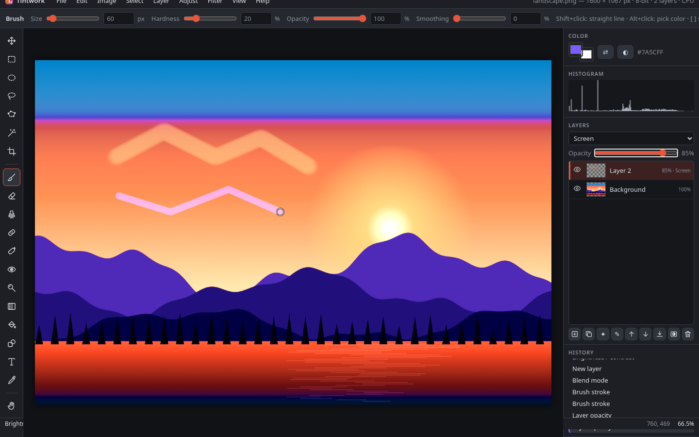

# Tintwork

An original, browser-based layered image editor built on the HTML Canvas 2D API.
No frameworks, no build step, no server-side processing: images never leave your browser.

Tintwork takes general inspiration from what desktop photo editors can do (layers, tools,
adjustments, filters, history) but has its own name, UI, icons and code. It does not use
any third-party branding, assets or proprietary code.



## What's new in v0.6 (Windows desktop, Chrome and Edge first)


- **WebGPU compute engine** (`src/webgpu.js`) is now the main engine on Chrome and Edge. The order is WebGPU, then WebGL2, then CPU. **View ▸ Rendering engine…** offers Automatic, WebGPU, WebGL2 (GPU) or CPU and shows the adapter, its limits and memory use (screenshot `6x-engine-webgpu.png`).
  - It covers compositing (every blend mode, opacity, masks, adjustment layers), blur, curves/levels LUTs, hue/saturation and the other point adjustments, plus brush-dab stamping.
  - Pipelines are specialized per blend mode and operation (constants are baked in, which is about 3x faster than branching at runtime).
  - Blur uses a bilinear "paired-tap" gather shader, which halves the texture reads. It runs 4x faster than the v0.6 shared-memory version, and the output is identical.
  - On a real GPU, results go straight to the canvas. On software adapters (SwiftShader) they are read back instead. Automatic mode still chooses the CPU when the adapter is software or fails the speed probe.
- **File System Access** (Chrome/Edge): **Ctrl+S** saves in place, and the first save goes through Save As. **Ctrl+Shift+S** always asks where to save. Export uses the save picker. An opened JPEG/PNG is never overwritten by a project save. **File ▸ Open recent** keeps file handles in IndexedDB (screenshot `6x-open-recent.png`). Browsers without the API fall back to download and upload.
- **Installable app (PWA)**: window controls overlay, file handling (opening .png/.jpg/.webp/.tintwork from Explorer), app shortcuts (`?action=new`, `?action=open`) and an offline shell. The title bar shows the document name, with • when there are unsaved changes.
- **Mouse precision** (the essentials only):
  - a stroke stabilizer ("smoothing" 0–100, string model with catch-up);
  - **[ ]** brush size and **Shift+[ ]** hardness;
  - cursor-anchored wheel zoom;
  - right-click menus on the canvas and on layers (screenshot `6x-context-menu.png`).
- **New core tools**:
  - **Gradient (G)**: linear, radial or reflected; foreground→background or foreground→transparent; reverse and opacity. It respects soft selections. Shift snaps to 45°. On a mask it paints the mask. 8-bit output is dithered, and in a 16-bit document the gradient is computed at 16 bits.
  - **Shapes (U)**: rectangle, rounded rectangle, ellipse and line. Each can be fill, stroke or both, and each lands on its own new layer. Shift draws a square, circle or 45° line; Ctrl draws from the centre. A live preview shows while you drag (screenshot `6x-shape-preview.png`).
  - **Dodge / Burn (O)**: targets shadows, midtones or highlights with an exposure setting. Alt switches to the opposite mode.
  - **Red eye (J)**: click a pupil. The pupil size and darken amount are adjustable.
  - Pressing a tool key again cycles through the tools that share it: G gradient/fill, O ellipse select/dodge-burn, J spot heal/red eye.
- Fixes:
  - Opening a project now names the document after its file.
  - The window title is no longer overwritten.
  - Context-menu commands no longer run twice.

### v0.6 benchmarks (`npm run bench`, raw log in `docs/bench-v0.6.log`)

These were measured on the same Linux box with **no GPU**. Chromium's WebGPU adapter is **SwiftShader (software)** and uses readback output. WebGL2 is ANGLE on SwiftShader. These GPU numbers measure a CPU emulating a GPU, so they are **not representative of a real Windows GPU**. They do show that the WebGPU path is correct and how its cost scales. Automatic mode chooses the CPU path on this box. Times are in ms per operation, and the GPU columns include upload and readback.

| Operation (Chromium) | CPU / worker | WebGL2 (SwiftShader) | WebGPU (SwiftShader) |
|---|---|---|---|
| Gaussian blur 25 px, 12 MP | 2012 | 6291 | 6975 |
| Gaussian blur 25 px, 24 MP | 3385 | 13459 | 13000 |
| Curves, 12 MP | 72 | 299 | 443 |
| Curves, 24 MP | 130 | 633 | 1013 |
| 10-layer composite, 12 MP (cold / warm) | 549 / 301 | 4309 / 3549 | 6484 / 4115 |
| 10-layer composite, 24 MP (cold / warm) | 1134 / 615 | 9436 / 7175 | 12196 / 8030 |
| Large brush stroke, 12 MP | 384 | 410 (CPU path) | 3709 (async engine call) |
| Large brush stroke, 24 MP | 490 | 566 (CPU path) | 6479 (async engine call) |

GPU memory for the 10-layer composite: WebGL2 used 916 MB at 12 MP and 1831 MB at 24 MP; WebGPU used 1099 MB and 2197 MB.

Before the paired-tap shader, the WebGPU blur took 29,813 ms at 12 MP. The WebKit run (software GL, CPU fallback) is in the log.

## What's new in v0.5

- **GPU engine (WebGL2)** with an automatic CPU fallback. Layers, every blend mode, opacity, layer masks, adjustment layers and live filters are composited in half-float or float textures. Gaussian blur (separable), sharpen, noise, vignette, curves/levels (LUT textures), hue/saturation, exposure, brightness/contrast, invert, grayscale and sepia run as shaders.
  - **View ▸ Rendering engine…** offers Automatic, GPU or CPU, and shows the renderer, texture limits, GPU memory use and the speed-probe time. The status bar shows `GPU` or `CPU`.
  - Automatic mode uses the GPU only when it is real hardware and passes a 1 MP blur probe (≤ 40 ms). Software rasterizers such as SwiftShader or llvmpipe stay on the faster CPU/worker path.
  - The CPU path takes over, with a notice, when WebGL2 or float render targets are missing, when the GPU context is lost, or when a document exceeds the max texture size or the GPU memory budget (1.5 GB on desktop, 384 MB on iOS). Large images are drawn back in tiles (2048 px on iOS).
- **16 bits per channel**: Image ▸ Mode: 8 / 16 bits/channel. In 16-bit mode, layer pixels are stored as 16-bit and the canvas you see is an 8-bit proxy.
  - Adjustments, adjustment layers, merge down and flatten work at 16 bits. An optional setting runs blur and sharpen in linear light.
  - Opening a 16-bit PNG creates a 16-bit document. There is a **PNG 16-bit** export, and 8-bit exports of a 16-bit document are dithered.
  - Project files are now format v5 and store 16-bit layers as 16-bit PNG; v4 files still open. Autosave keeps the 16-bit data of the current step, up to 8 MP (4 MP on iOS).
  - The PNG codec is in `src/png.js` and uses the bundled [fflate](vendor/fflate/LICENSE) (MIT) for deflate.
- **Platform-aware keyboard**: Windows and Linux use Ctrl, Alt and Shift; macOS uses ⌘, ⌥ and ⇧. Menus, tooltips, hints and the shortcuts dialog show the right names for the platform.
  - Combinations the browser or OS keeps for itself (Ctrl+N, Ctrl+T, Ctrl+W, Ctrl+Shift+N, Ctrl+Shift+I/C on Windows; ⌘N, ⌘T, ⌘W, ⌘Q, ⌘M on Mac) get alternates: Ctrl+Alt+N new canvas, Ctrl+Alt+Shift+N new layer, Ctrl+Alt+T free transform, Shift+F7 invert selection, ⇧⌘M curves on Mac. The usual combination still works wherever the browser passes it on.
  - Ctrl+Y and Ctrl+Shift+Z both redo. You can force the platform with `?platform=win|mac`.
- **Comparison doc**: [docs/COMPARISON.md](docs/COMPARISON.md) compares each milestone's features with current paid editors, with sources.

### v0.5 benchmarks (`npm run bench`)

These were measured on this Linux box with **no GPU**. Headless Chromium renders WebGL2 with **SwiftShader**, a software emulation. Headless WebKit reports a masked "Apple GPU" but also renders in software (Mesa). So the GPU column measures a CPU pretending to be a GPU, and it is **not representative of real hardware**; on a real GPU these shaders are expected to be much faster. That is also why automatic mode picked the CPU path here. Times are in ms per operation, including texture upload and readback.

| Operation | Chromium GPU (SwiftShader) | Chromium CPU / worker | WebKit GPU (software) | WebKit CPU |
|---|---|---|---|---|
| Gaussian blur 25 px, 12 MP | 5907 | 1794 | 1569 | 1239 |
| Gaussian blur 25 px, 24 MP | 12092 | 3888 | 3389 | 2765 |
| Curves, 12 MP | 307 | 79 | 105 | 59 |
| Curves, 24 MP | 657 | 149 | 230 | 133 |
| 10-layer composite, 12 MP (cold / one layer changed) | 4627 / 3633 | 341 | 1935 / 445 | 366 |
| 10-layer composite, 24 MP (cold / one layer changed) | 9106 / 7582 | 1086 | 4138 / 981 | 585 |

GPU memory for the 10-layer composite was 916 MB at 12 MP and 2426 MB at 24 MP (half-float textures, budget raised to 4 GB for the benchmark).

**Banding** (a 4096 px ramp covering levels 100–140, stretched to the full range by a steep curve):

| Pipeline | Distinct output levels |
|---|---|
| 8-bit | 41 |
| 16-bit (internal) | 4062 |
| 16-bit result shown or exported at 8 bits | 256 |

The default dithered 8-bit export has a mean error of 0.33 levels.

## What's new in v0.4

- **Blend modes on adjustment layers**: an adjustment layer's blend mode (Multiply, Screen, Overlay, …) is honored together with its opacity and mask, both live and when it is merged down.
- **Live (non-destructive) filters**: Layer ▸ Convert to live layer (also in the Filter menu) keeps the original pixels. Gaussian blur, sharpen, noise and vignette then stack on top of them:
  - Every filter in the stack can be shown or hidden, re-edited (✎ or double-click in the Layers panel), reordered or deleted from the live filter panel (✎ on the layer).
  - A filter mask limits where the filters apply. You can make it from the selection, paint it (click its thumbnail), invert it or disable it (Shift+click).
  - The stack is saved in project files (format v4), undo restores it, and Layer ▸ Convert to pixels bakes it.
- **Free transform** (Edit ▸ Free transform, Ctrl+T, or Transform in the Move tool's bar), for layers and for selected pixels:
  - Corner and edge handles scale, Shift keeps the aspect ratio, dragging outside the box rotates (Shift snaps to 15°), and Ctrl+drag on a handle skews.
  - The options bar has numeric W/H %, angle and skew fields. Enter or Apply commits as one undo step; Esc or Cancel restores.
  - On a phone, two fingers scale, rotate and move the piece instead of the view.
  - Live layers transform their original pixels, so their filters re-render.
- **Autosave with history and recovery slots**: each document autosaves with its last 20 undo steps, and the 5 newest unsaved documents are kept. After a crash or reload the recovery prompt lists each one with its step count. Recovered documents can be undone straight away.
- **Select ▸ Color range…**: sampled color (click the canvas while the dialog is open) with fuzziness, hue presets (reds … magentas) and highlights/midtones/shadows. It has a live mask preview and combines with the selection mode.
- **Select ▸ Refine edge…** (Ctrl+Alt+R): smooth, feather and contract/expand, with a live preview of the selection.
- **Bundled open-licensed fonts** for text: Inter, Lora, Bebas Neue, Pacifico and JetBrains Mono (SIL OFL 1.1, Latin-subset WOFF2). They are served locally from `fonts/` with their licenses (see `fonts/README.md`) and cached for offline use.

## What's new in v0.3

- **Adjustment layers** (Layer ▸ New adjustment layer, or the ✦ button in the Layers panel): brightness/contrast, hue/saturation, exposure, levels, curves, invert and grayscale. They work non-destructively: each one re-renders the layers below it, and nothing is baked in. To change the settings, double-click the layer thumbnail or press ✎. Every adjustment layer has a mask. If a selection is active when you create one, the mask is made from that selection. Merge down bakes the adjustment into pixels.
- **Curves** with an interactive point editor (Adjust ▸ Curves…, Ctrl+M, or as an adjustment layer):
  - Composite RGB plus R, G and B tabs, drawn over a histogram, with a monotone smooth curve.
  - Click to add a point and drag it. Drag a point off the graph, double-click it or press Delete to remove it. Arrow keys nudge a point. Reset restores the curve and an In/Out readout shows the values.
- **Editable text layers**: to change the text, font, size, bold/italic, color or alignment, click the layer with the Text tool, double-click its thumbnail or press ✎. Changing the alignment keeps the text block in place. Painting, filters and transforms first ask to rasterize the layer, and Layer ▸ Rasterize does it manually.
- **Healing brush** (R; Alt+click sets the source) and **spot healing** (J): these match the texture from the source to the color and tone around the target.
- **Ellipse selection** (O; Shift/Alt/Shift+Alt add, subtract and intersect; Ctrl draws from the center).
- **Move selected pixels**: with a selection active, the Move tool lifts and moves just those pixels, and Alt+drag duplicates them. Arrow keys nudge.
- **Autosave and crash recovery**: about 1.5 s after each change, and when the page is hidden, the document is saved to IndexedDB (layers, masks, adjustment and text settings). After a crash or reload you get a "Recover unsaved work?" prompt. File ▸ Recover autosave… restores it manually.
- **Mobile / iPhone**: a touch layout with bottom sheets for tools, layers, history and adjustments.
  - Pinch to zoom, two-finger pan, and on-screen Shift/Alt/Ctrl modifier chips.
  - Sharing an export uses the Web Share API.
  - The app is an installable PWA with an offline service worker. iOS Safari is the main target.

## Features (v0.2)

**Files**
- Open an image via file picker (Ctrl+O), drag and drop, or paste from the clipboard
- New blank canvas with presets and white / background-color / transparent fill (Ctrl+N)
- Place an image as a new layer (Ctrl+Shift+O, or drop onto an open document; hold Shift while dropping to open instead)
- Export PNG, JPEG or WebP with a quality setting (Ctrl+Shift+E); JPEG is flattened onto white
- Save / load a project file (`*.tintwork.json`: JSON with one PNG data URL per layer, plus name, visibility, opacity, blend mode, offset and the layer mask with its enabled state). v0.1 projects still open.

**Layers**
- Add, delete, duplicate, rename (double-click), reorder (drag in the list or ▲/▼), merge down, flatten
- Visibility, opacity and 16 blend modes (Canvas `globalCompositeOperation`: multiply, screen, overlay, soft light, difference, hue, color, luminosity and more)
- Live thumbnails
- **Layer masks** (new in v0.2): add a mask that reveals everything or one made from the selection. Paint on it with the brush, eraser or fill: black hides, white reveals and grays are partial. The eraser always hides. Gaussian blur and invert also work on a mask. Click the mask thumbnail to edit the mask and the layer thumbnail to edit pixels (or press `\`). Shift+click the mask thumbnail to enable or disable it; a red X marks a disabled mask. Commands to apply (bake into alpha), invert and delete masks are in Layer ▸ mask commands. Masks follow transforms, crop, resize, duplicate and merge, and they are kept in undo history and project files.

**Tools** (left toolbar)
| Tool | Key | Notes |
|---|---|---|
| Move | V | Drag the active layer, or the selected pixels when there is a selection (Alt duplicates); arrow keys nudge (Shift = 10 px) |
| Rectangle select | M | Drag a rectangle |
| Lasso | L | Freehand outline |
| Polygonal lasso | P | Click points; close with double-click, Enter or a click on the start point; Backspace removes a point; Esc cancels |
| Magic wand | W | Selects by color with tolerance, contiguous or global, active layer or all layers; reuses the fill tool's flood-fill code |
| Crop | C | Drag, then Enter to apply / Esc to cancel |
| Brush | B | Size, hardness, opacity; Shift+click draws a straight line; Alt+click picks a color |
| Eraser | E | Size, hardness, opacity |
| Clone stamp | S | Alt+click sets the source, then paint to copy pixels. Size, hardness and opacity settings; aligned or non-aligned; a crosshair shows the source point |
| Fill | G | Tolerance, contiguous or global |
| Ellipse select | O | Drag an ellipse; Ctrl draws from the center |
| Healing brush / Spot healing | R / J | Alt+click sets the healing source; spot healing samples around the spot automatically |
| Text | T | Click to place, or click an existing text layer to edit it; font, size, bold/italic, color, alignment, live preview |
| Color picker | I | Sample the merged image or the current layer |
| Hand / Zoom | H / Z | Also: hold Space to pan, mouse wheel to zoom at the cursor, middle-drag to pan |

**Selections** (new in v0.2): selections are 8-bit masks, so they can have soft edges.
- Every selection tool has New, Add, Subtract and Intersect modes. Pick one in the options bar, or hold Shift to add, Alt to subtract, or Shift+Alt to intersect.
- The Select menu has All (Ctrl+A), Deselect (Ctrl+D), Invert (Ctrl+Shift+I), Feather… (Shift+F6, a Gaussian blur of the mask), Select layer pixels (from alpha) and Crop to selection.
- Animated marching ants trace the actual mask outline.
- The selection limits brush, eraser and clone strokes, Fill, Clear, Fill with color, Copy, and every adjustment and filter. Soft (feathered) selections blend partially.

**Image / transform**: rotate 90° CW / CCW / 180°, flip horizontal / vertical (whole image or a single layer), image size (resample with proportional lock), canvas size (9-point anchor), crop to selection.

**Adjustments** (live preview, then OK to apply or Cancel to revert; applied to the selection when there is one)
- Brightness / contrast, Hue / saturation / lightness, Exposure (EV, offset, gamma)
- Levels with a histogram (input black / white, midtone gamma, output range), Auto levels
- Invert, Grayscale, Sepia tone

**Filters**: Gaussian blur (3-pass box approximation with premultiplied alpha), Sharpen (unsharp mask with threshold), Add noise (mono or color), Vignette (darken or lighten edges, size, feather).

**Background processing** (new in v0.2): adjustments, filters and feathering run in a module Web Worker (`src/worker.js`) using transferable buffers.
- Previews are coalesced, so only the latest slider value is processed. The status bar shows "Processing…" while a job is running.
- If module workers are unavailable, the same code runs on the main thread instead.
- In the test, a 25 px blur of a 4000×3000 image blocks the page for about 1.6 s when run inline. Through the worker, the longest UI stall was about 0.1 s.

**History & UX**
- Undo / redo (Ctrl+Z / Ctrl+Shift+Z or Ctrl+Y) and a clickable history panel (jump to any step); up to 60 steps. Unchanged layer bitmaps are shared between steps to save memory.
- Live histogram panel, marching-ants selection, brush outline cursor, zoom 2%–6400% with pixel-crisp rendering when zoomed in
- Keyboard shortcuts for almost everything (press `?` in the app for the list)
- Dark UI: menu bar, tool options bar, left toolbar, right panels (color, histogram, layers, history), status bar

## Run it

Requires Node 18+ (only to serve static files and run the tests).

```bash
cd photo-editor
npm install          # installs the static server and Playwright (dev only)
npm start            # serves on http://localhost:5173
```

To try it on a phone on the same network, run `npm run serve` (`scripts/serve.mjs`, port 8080, with no-cache headers suitable for the service worker). Add it to the home screen to install it.

Any static file server works, e.g. `python3 -m http.server 5173`. It needs to be served over
http(s) rather than opened as a `file://` URL because it uses ES modules.

### Tests and screenshots

```bash
npx playwright install chromium webkit   # one time
npm test                 # desktop smoke test, desktop platform test (Chromium + WebKit), then mobile tests
npm run test:platform    # scripts/desktop-platform-test.mjs: Windows/Mac keyboard labels and shortcuts
npm run bench            # scripts/bench.mjs: GPU vs CPU timings and banding
npm run test:desktop     # scripts/smoke-test.mjs (Chromium)
npm run test:mobile      # scripts/mobile-test.mjs (WebKit iPhone 14 + Chromium Pixel 7, touch input)
```

The smoke test starts a temporary server, opens a generated test photo in headless Chromium, applies
hue/saturation and brightness/contrast, adds a Screen-blended layer with brush strokes, adds text, applies a vignette,
converts a selection to grayscale, runs levels and sharpen, undoes and redoes, rotates, exports PNG/JPEG/WebP, saves and reloads a project,
drops a file, and crops. The v0.2 part checks pixels for:
- Lasso, add, subtract and intersect modes, the polygonal lasso and the magic wand.
- Invert, select all and deselect.
- Feathering, and an adjustment through a feathered selection.
- Selection undo.
- Layer masks: paint, erase, reveal, disable, project round-trip, apply, delete and mask from selection.
- Worker availability and UI responsiveness on a 4000×3000 image.
- The clone stamp.

v0.3 adds pixel checks for:
- Every adjustment-layer type, including mask and selection-limited masks, re-editing, cancel, undo and project round-trip, and the cache.
- Curves editor point add, drag, remove and reset.
- Text-layer re-edit, alignment and rasterize.
- Healing.
- Ellipse modes, moving and duplicating selected pixels, and cancel.
- Autosave write, reload, recover and discard.

v0.4 adds pixel checks for:
- Adjustment-layer blend modes, including opacity, merge down and masks.
- Live filters: add, hide, re-edit, stack, filter mask from selection and by painting, undo/redo, project round-trip and convert to pixels.
- Free transform: scale with Shift, numeric rotate, drag-rotate with snap, cancel, skew, undo and selection transform.
- Recovery slots with a bounded 20-step history, eviction beyond 5 slots and undo after recovery.
- Color range: sampling, presets and tonal ranges.
- Refine edge: expand, contract, feather and smooth.
- Bundled fonts: serving, loading and glyph rendering.

v0.5 adds checks for:
- GPU vs CPU composite parity in 30 cases (every blend mode, masks, 7 adjustment-layer types × 2 blend modes): max difference ≤ 4 levels, mean < 0.5.
- Filter parity: point operations within 2 levels; blur and sharpen mean < 1.5 (the GPU uses a true Gaussian, the CPU three box passes); noise statistically equal.
- Live filters on the GPU.
- 16-bit banding (41 vs 175 levels after a squeeze and stretch), undo, an exact 16-bit PNG round trip, dithered 8-bit export, an exact project v5 round trip, opening a 16-bit PNG, and merge down in 16-bit.
- The engine dialog, the forced-CPU mode, the memory-budget notice, and a page without WebGL2 (the fallback path).
- The desktop platform test: Windows labels and shortcuts in Chromium and WebKit, and Mac labels and ⌘ shortcuts in WebKit.
- On mobile (`m-v5-*`): forcing the GPU, the iPhone limits (384 MB, 2048 px tiles), composite parity, a 16-bit document with 16-bit PNG export, and the engine dialog layout.

The mobile test (screenshots `m-v4-*`) adds a two-finger pinch/rotate transform, a live blur toggled from the layers sheet, a color-range tap sample, a bundled-font text layer, and recovery of one of two slots with its 20-step history.

The mobile test covers on both devices:
- Touch drawing, pinch zoom, the modifier chips and the sheets.
- Adding a curves layer and dragging its curve by touch.
- Text by tap, an ellipse plus a one-finger move, and autosave recovery after a reload.
- The offline service worker.

Screenshots are written to `screenshots/`:

| File | Shows |
|---|---|
| `01-welcome.png` | Empty workspace |
| `02-opened.png` | Test image opened |
| `03-hue-saturation-preview.png` | Adjustment dialog with live preview |
| `04-layer-blend-brush.png` | New layer in Screen mode at 85% with brush strokes, history panel |
| `05-selection-grayscale.png` | Grayscale applied only inside a rectangle selection |
| `06-history-levels-sharpen.png` | Text layer, vignette, levels, sharpen, full history |
| `07-crop-preview.png` | Crop tool overlay with rule-of-thirds guides |
| `08-after-crop.png` | Result after crop |
| `09-filter-menu.png` | Filter menu |
| `10-lasso-selection.png` | Lasso plus added rectangle with a subtracted hole (marching ants) |
| `11-magic-wand.png` | Magic wand selection of one color region |
| `12-feather-adjust.png` | Invert applied through a 20 px feathered selection |
| `13-layer-mask.png` | Layer mask painted with brush and eraser, mask thumbnail targeted |
| `14-worker-large.png` | 4000×3000 image blurring in the worker with the UI live ("Processing…") |
| `15-clone-stamp.png` | Clone stamp stroke with the source crosshair |
| `20-heal-before.png`, `21-heal-after.png` | Healing brush / spot healing before and after |
| `2x-adjust-invert-masked.png` | Invert adjustment layer limited by its mask |
| `2x-curves-editor.png` | Curves editor with points over the histogram |
| `2x-adjust-layers-panel.png` | Layers panel with adjustment layers |
| `2x-text-edit.png`, `2x-text-layers.png` | Re-editing a text layer; text layers with alignment |
| `2x-ellipse-select.png`, `2x-move-selection.png` | Ellipse selection; selected pixels moved |
| `2x-autosave-recover.png`, `2x-autosave-recovered.png` | Recovery prompt after reload; recovered document |
| `m-iphone-*.png`, `m-pixel-*.png` | Mobile: welcome, opened, pinch-zoomed, selection modifiers, tools/layers/history/adjust/menu sheets, adjust dialog, export, landscape, curves, text, recover |

## Project layout

```
index.html            app shell
src/main.js           state, rendering, tools, layers, history, dialogs, file I/O
src/pixels.js         pixel operations (adjustments, blur, sharpen, noise, vignette, flood fill, histogram, runOp dispatcher)
src/selection.js      mask-based selections (combine modes, invert, outline path, clipping canvas)
src/worker.js         Web Worker that runs pixel operations off the main thread
src/ops.js            promise client for the worker with a main-thread fallback
src/curves-editor.js  interactive curves point editor (canvas)
src/autosave.js       IndexedDB autosave / recovery (slots, bounded history)
src/gpu.js            WebGL2 engine: compositing, blend modes, masks, filter shaders, texture budget
src/deep.js           16-bit (Uint16) layer data: blending, compositing, adjustments
src/png.js            PNG decoder/encoder (8 and 16 bit)
src/platform.js       Mac vs Windows/Linux modifiers, key labels, reserved shortcuts
vendor/fflate/        bundled deflate library (MIT)
docs/COMPARISON.md    living comparison with paid editors
scripts/bench.mjs     GPU vs CPU benchmark
fonts/                bundled OFL web fonts + licenses
src/icons.js          original SVG icons
src/styles.css        dark theme
scripts/smoke-test.mjs  Playwright end-to-end test and screenshot generator
scripts/mobile-test.mjs Playwright mobile (WebKit iPhone / Chromium Pixel) touch tests
scripts/serve.mjs     tiny static server for phones on the LAN
sw.js, manifest.webmanifest  PWA offline shell
test-assets/          generated test image (export outputs are git-ignored)
```

`window.tintwork` exposes the state and commands for scripting and testing from the devtools console.

## Known limitations

- On documents over 2.5 MP, adjustment layers and live filters are computed in the worker, so the previous result shows briefly after each edit.
- Live filters cover Gaussian blur, sharpen, noise and vignette only, and there is one filter mask per layer. Transforming a selection on a live layer converts it to pixels. Text layers are rasterized when converted.
- Free transform has no perspective or warp yet (moved to the next milestone). Resampling is bilinear (canvas smoothing), so repeated transforms of a pixel layer soften it; live layers keep their original pixels, but those originals are resampled too.
- Color range uses one sample color (no add/subtract eyedroppers or localized clusters), and its preview is downscaled. Refine edge has no hair/edge detection or color decontamination.
- Autosave keeps the last 20 undo steps per document and 5 documents. iOS Safari may evict website storage after several days without use, so autosave is not a backup; save a project file.
- Bundled fonts are Latin-subset only, with 400/700 weights (Bebas Neue and Pacifico 400 only). There is no per-character styling, paragraph boxes or text on a path, and transforms and filters rasterize a text layer.
- Masks are pixel-only (there are no vector masks or clipping masks). Of the adjustments, only Gaussian blur and invert apply to a mask.
- The clone stamp samples the active layer only, as it was when the stroke started. There is no "sample all layers" option for clone or heal.
- History stores full layer snapshots (shared when unchanged), so very large images with many steps use a lot of memory.
- Reading and writing pixels (`getImageData`/`putImageData`) still happens on the main thread, which costs roughly 0.1 s per step on a 12 MP image. Brush strokes, the magic wand and selection outlines are computed on the main thread too.
- Masks and selections are full document-size 8-bit arrays, so very large documents use more memory.
- 16-bit, not 32-bit: there is no HDR/float mode, color management (ICC), CMYK or RAW. The PNG decoder ignores gAMA/iCCP and assumes sRGB. 16-bit TIFF/PSD are not supported.
- In 16-bit mode, brushes, the eraser, clone/heal, transforms and moving selected pixels edit the 8-bit proxy and are then reconciled. Pixels they touch drop to 8-bit precision; untouched pixels keep 16-bit.
- GPU and CPU differ slightly: blur is a true Gaussian on the GPU and a 3-box approximation on the CPU (mean difference under 1 level), and noise uses a different random pattern. Linear-light blur and sharpen run on the CPU only.
- The GPU path runs on the main thread. On software GL it is slower than the CPU worker, so automatic mode avoids it there.
- WebGPU: headless/software adapters use the readback output (slower). Direct canvas output is only used on real GPUs, and it has not been benchmarked on Windows hardware from this box. WebGL2 has no brush path, so brushes fall back to the CPU there. WebGPU brush stamping is an async engine call and only pays off on a real GPU.
- Shapes are raster layers (not editable vector shapes). Gradients have no editor for multi-stop presets, no angle or diamond types, and no gradient fill layer. Dodge/burn and red eye work on 8-bit pixels: in a 16-bit document, touched pixels drop to 8-bit precision, as with other brushes.
- Deferred by request: mouse side-button mapping, deep accessibility and input customization.
- Brush has no pressure sensitivity, spacing or texture settings yet.
- Single open document at a time (tabs are not implemented).

## Roadmap

Milestones to 1.0 (Windows desktop, Chrome and Edge first; Mac and iPhone kept working):
- ~~**v0.6**: WebGPU engine (with WebGL2 then CPU fallback), File System Access, installable PWA, Windows conventions, mouse precision, shapes, gradients, dodge/burn, red-eye~~ (done). Warp and perspective transform move to v0.7.
- **v0.7**: groups, clipping masks, layer styles, warp and perspective transform.
- **v0.8**: auto enhance, auto white balance, straighten, looks and presets.
- **v0.9**: multi-document tabs, crop presets, batch export.
- **v1.0**: onboarding, help, accessibility, error handling, memory tuning, full tests, user guide.

Longer-term items:


1. ~~Layer masks~~ (done in v0.2). Next: clipping masks and vector masks.
2. ~~Lasso, polygonal lasso, magic wand, add/subtract/intersect, feather~~ (done in v0.2). ~~Ellipse, select-and-move pixels~~ (v0.3). ~~Color range, refine edge, free transform of selections~~ (v0.4). Next: a quick-mask editing mode, and saved selections.
3. **Non-destructive editing**: ~~adjustment layers, editable text layers~~ (v0.3), ~~live filters, adjustment blend modes~~ (v0.4). Next: clipping masks, more live filters.
4. **Retouching**: ~~clone stamp~~ (done in v0.2), ~~healing brush, spot healing~~ (v0.3), ~~dodge/burn, red eye~~ (v0.6), smudge.
5. **History snapshots**: named snapshots, a history brush, and IndexedDB-backed history so large documents don't run out of memory.
6. ~~**Curves** with a point editor~~ (v0.3). Next: per-channel levels/curves, color balance, vibrance, white balance, LUT import (.cube).
7. **Performance**: ~~Web Worker for filters~~ (done in v0.2), ~~WebGL2 GPU pipeline, 16-bit~~ (v0.5). ~~WebGPU compute engine as the primary path on Chrome/Edge~~ (v0.6). Next: OffscreenCanvas, tiled rendering for very large images.
8. **RAW support** via a WASM decoder (e.g. LibRaw compiled to WASM), EXIF reading and orientation, 16-bit pipeline.
9. **Plugin system**: a sandboxed filter/tool API (worker-based, ImageData in/out), a manifest format and a plugin manager.
10. **Packaging**: installable PWA with offline cache and file handling, and desktop builds (Tauri or Electron) with native open/save dialogs.
11. Multiple documents (tabs), ~~autosave and recovery~~ (v0.3), ~~recovery slots with history~~ (v0.4), pen pressure, custom brushes, guides, rulers and snapping.

## License

MIT, original code. Bundled fonts in `fonts/` are under the SIL Open Font License 1.1 (see each `OFL.txt`). The name "Tintwork" is a working title for this project.
